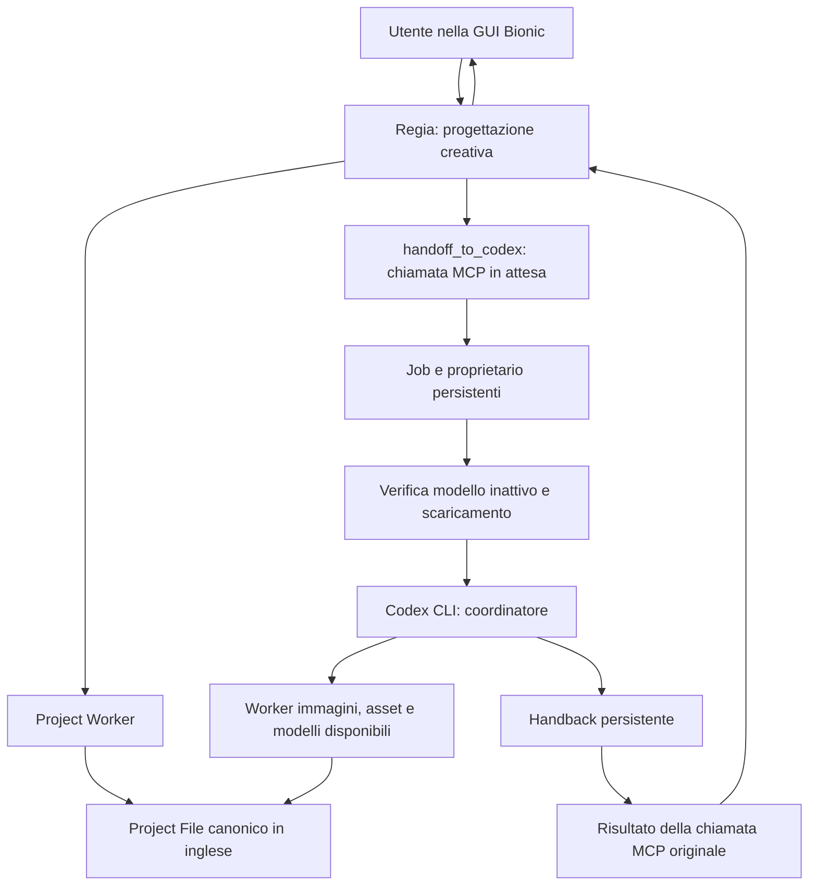

# Orchestrazione Bionic: stato, implementazione e verifiche

4 ottobre 2026 — PC Windows dell'utente, fuso Europe/Warsaw.

**Terminologia:** in questa documentazione, il **PC locale** è la destinazione del progetto di gioco e dei suoi file; il **PC cloud** è la destinazione dei modelli locali e dei worker che li eseguono. Le verifiche descritte in questo rapporto sono state eseguite su un singolo host Windows e non dimostrano un dispatch tra due macchine.

## Risultato di questa fase

Ho esteso il Project Worker esistente con un protocollo persistente Regia → Codex → Regia. Due cicli consecutivi con il vero Codex CLI e un vero client MCP sono riusciti su un progetto isolato. Nel secondo ciclo l'attesa MCP e stata annullata e poi ripresa: il job ha continuato e l'handback e stato recuperato senza avviare un secondo job.

Il ritorno scelto e **il risultato della chiamata MCP originale**, sostenuto da un handback persistente. Non viene creato artificialmente un messaggio `user`. Bionic resta responsabile della sua cronologia.

**La convalida completa dentro la GUI Bionic resta da effettuare.** Il test integrato ha usato un client MCP isolato e un database di sessioni sintetico. Non dimostra ancora che Bionic mantenga un tool lungo in attesa mentre il modello viene scaricato, ne che lo ricarichi e prosegua automaticamente dopo quel tool. Il caricamento/scaricamento e la persistenza della sessione sono stati verificati separatamente; il percorso di ricaricamento al prossimo `ngPredictTokens` e confermato dal codice. Questa distinzione e essenziale prima di considerare il sistema completamente collaudato.

## Architettura realmente scoperta

| Componente | Dove si trova oggi | Responsabilita |
|---|---|---|
| Bionic / Regia | Host Windows usato nel test, `C:\Users\Shadow\AppData\Local\Programs\Bionic` | Conversazione creativa e cronologia originale |
| Project Worker | Host Windows usato nel test, `C:\Users\Shadow\.lmstudio\project-worker\mcp` | Project File canonico e protocollo di orchestrazione |
| Project File | Percorso operativo rilevato: `C:\AI\bionic\projects` | Conoscenza persistente in inglese; da ricollocare sul PC locale secondo la suddivisione architetturale |
| Codex CLI | Host Windows usato nel test, CLI 0.160.0, autenticato con ChatGPT | Coordinamento operativo; usa il modello configurato dall'utente |
| Image Worker | Host Windows usato nel test, copie identiche in `.lmstudio\image-worker\mcp` e `C:\AI\image-worker\mcp` | Generazione locale, revisione Codex, finalizzazione e pubblicazione |
| Asset Worker | Host Windows usato nel test, copie identiche in `.lmstudio\asset-worker\mcp` e `C:\AI\asset-worker` | Download dei file finali tramite rclone |
| Trasporto | `rclone`, remote `imagecloud:`, cartella `ImageWorker/final` | Trasferimento di immagini finalizzate |
| PC cloud | Macchina separata non disponibile nel test | Ruolo produttivo non verificato; l'Image Worker ha girato sull'host Windows di test |

La GPU fisica osservata nell'host di test e NVIDIA RTX A4500 con 19.190 MiB. Regia usa `qwen/qwen3.5-9b`. Image Worker usa `sd-cli.exe` con backend `cuda0`, quindi durante il test usa la GPU dello stesso host. I modelli e l'eseguibile immagini configurati risultano presenti. La GPU del PC cloud effettivo non e stata verificata; non le attribuisco un modello o una capacita.

Nella configurazione Bionic era abilitato solo Project Worker. Image Worker e Asset Worker erano disabilitati per Bionic, ma gia configurati e disponibili in Codex: questa separazione e stata conservata. Regia delega la produzione; Codex dispone dei Worker produttivi. Non ho abilitato quei Worker in Bionic.

Non ho trovato un servizio di dispatch di job verso un PC cloud separato. Il trasferimento file tramite rclone funziona, ma non equivale a un sistema remoto di esecuzione. Anche un Worker Writer dedicato non e presente nei percorsi ispezionati; sono disponibili modelli locali destinati alla scrittura. Il coordinatore deve segnalare una dipendenza mancante invece di dichiarare lavoro remoto o scrittura completati senza verifica.

## Flusso scelto



### Regia → Codex

Regia salva le decisioni creative nel Project File, legge hash e revisione, poi chiama `handoff_to_codex`. Il tool registra un job univoco, passa la proprieta a Codex, avvia un runner separato e attende l'handback. Il runner verifica l'associazione alla sessione e che il file non sia cambiato, poi verifica il modello e lo scarica se e inattivo. Nessuno scaricamento globale di tutti i modelli.

Il coordinatore viene avviato con `codex exec`, sandbox `workspace-write`, percorsi produttivi espliciti, schema della risposta e configurazione MCP per quella singola esecuzione. Riusa le configurazioni e l'autenticazione esistenti. Non cambia il modello predefinito dell'utente e non richiede una nuova API key. Ogni fase parte da un contesto Codex nuovo: il Project File e il riferimento persistente tra i cicli. L'ID della chat Codex viene registrato per diagnosi, senza usare `--last`.

I tool consentiti al coordinatore sono quelli produttivi dei tre Worker. Handoff ricorsivi, acknowledgement di Regia e cancellazione remota degli asset non fanno parte di questa allowlist. Non ho modificato la configurazione globale di Codex.

### Codex → Regia

Codex restituisce summary, task completati, asset, problemi, decisioni e domanda da porre all'utente. Il runner valida il formato e verifica che gli asset dichiarati siano file non vuoti nei percorsi produttivi previsti. Il risultato viene salvato, la proprieta torna a Regia e la chiamata MCP originale riceve l'handback.

Regia rilegge il Project File, incorpora i risultati nella conversazione creativa e chiama `acknowledge_handback`. Solo dopo l'acknowledgement si puo avviare un'altra fase.

Se l'attesa viene annullata, il runner continua separatamente. `wait_for_handback` recupera il risultato. Anche `read_project_file` riporta lo stato e l'eventuale handback. MCP da solo **non puo iniziare un nuovo turno in una chat gia chiusa o ferma**: in quel caso il recupero avviene al prossimo turno normale dell'utente. Non serve copiare messaggi tra applicazioni.

## Stato persistente e associazione automatica

Il Project File rimane il documento canonico. Lo stato operativo e affiancato in:

`C:\AI\bionic\projects\.orchestration`

Contiene schema/versione, PROJECT_ID UUID stabile, basename del Project File, associazione Bionic, proprietario, fase, revisione, job, timestamp, stato e handback. Non replica la narrativa completa. Conserva fino a 32 riepiloghi di cicli nello stato; richieste e risposte dei job hanno cartelle separate sotto `runs`.

Nuovi progetti: `create_project_file` genera il filename e registra l'identita. Progetti esistenti: `register_project` usa il filename gia esistente. Il tool restituisce un marcatore casuale. Un lettore SQLite **in sola lettura** cerca quel marcatore dentro un vero `toolCallResult`, verifica la corrispondente `toolCallRequest` e risale alla catena di una sessione raggiungibile dalla sua testa. Non usa titoli o la sessione piu recente. Per progetti precedenti al marcatore e prevista una migrazione tramite l'esatto risultato storico `PROJECT_FILE_CREATED` del filename univoco.

L'associazione persistente e:

`PROJECT_ID ↔ PROJECT_FILE ↔ BIONIC_PROJECT_ID ↔ REGIA_SESSION_ID`

Ho associato automaticamente il Project File di prova preesistente alla Regia originale. Il nuovo codice non contiene gli UUID della sessione di test. Gli UUID compaiono solamente nei dati dell'associazione e nei precedenti strumenti di indagine storici.

Un marcatore presente in piu catene, per esempio dopo un fork, viene rifiutato. Un database incompatibile o un'identita non verificabile bloccano l'avvio. Bionic non passa l'identita della chat chiamante nei normali tool MCP: il risultato va alla chiamata nativa che sta aspettando. Occorre quindi usare il Project File dalla sua Regia associata; non viene promesso un controllo del chiamante che MCP non fornisce. Dopo una nuova registrazione potrebbe essere necessario completare il turno prima che Bionic renda raggiungibile il risultato dalla testa persistente.

## VRAM e limiti dell'attesa

Durante un handoff il modello viene scaricato soltanto se si trova una singola istanza corrispondente, inattiva e senza richieste in coda. Il controllo viene ripetuto dopo mezzo secondo. Istanza ambigua o modello occupato producono un handback di errore. Una sola esecuzione coordinata alla volta per la stessa radice di progetti riduce i conflitti GPU.

La precedente prova di caricamento/scaricamento ha recuperato circa 9,6 GiB. All'ultimo controllo di questa fase non risultavano modelli caricati e la VRAM usata era circa 1.355 MiB (era 1.176 MiB al controllo precedente; la memoria degli altri processi varia). La testa originale della sessione Regia e rimasta `4bd6ac4d-5584-432e-925c-ff3c311e2be5`.

La ricarica prevista dopo il risultato MCP e effettuata da Bionic al successivo `ngPredictTokens`; non precarico permanentemente Regia. I comandi manuali di memoria sono stati generalizzati:

```powershell
.\regia-bridge.ps1 status -ProjectFile project_worker_test_20261003_202926_c73d0d.md
.\regia-bridge.ps1 suspend -ProjectFile project_worker_test_20261003_202926_c73d0d.md
.\regia-bridge.ps1 resume -ProjectFile project_worker_test_20261003_202926_c73d0d.md
```

Il limite configurato del coordinatore e dell'attesa e 30 minuti; il timeout del collegamento MCP Bionic e 35 minuti. Una fase piu lunga o piu job in coda possono superare l'attesa e richiedere il recupero successivo. Se si annulla l'attesa e si riprende Regia mentre una produzione GPU e ancora in corso, la nuova ricarica puo competere per VRAM. Il controllo CLI di inattivita e lo scaricamento non sono atomici, e lo stesso modello puo essere condiviso da altre chat: non e un sistema di prenotazione GPU a livello del runtime Bionic.

## Errori, riavvii e PC cloud indisponibile

- Aggiornamenti atomici del Project File, con backup della versione precedente.
- Hash atteso per evitare sovrascritture concorrenti.
- Revisione attesa e proprietario per rifiutare handoff duplicati.
- Job persistente indipendente dalla connessione MCP in attesa.
- Errori dei Worker/dependency e risposte con problemi restituiscono un handback `error`.
- Runner e coordinatore morti producono un handback `interrupted`; nessun replay automatico di effetti gia avvenuti.
- `resume_queued_job` puo avviare un job ancora in coda con launcher morto; rifiuta un launcher vivo.
- Prima di affidare lavoro a un PC cloud separato, dispatch e heartbeat dovranno essere collegati. Il test di indisponibilita riguarda una dipendenza simulata, non un computer remoto.

Non salvo stdout/stderr arbitrari di Codex e dei suoi tool nei log del runner. Registro soltanto gli identificatori necessari e i riepiloghi strutturati; richieste operative e stato restano locali.

## Confronto delle alternative

| Soluzione | Esito |
|---|---|
| API ufficiale / REST stateful chat | Non e stata identificata una mappatura supportata verso questa sessione Bionic esistente |
| IPC/RPC interno `sendUserDraft` | Protocollo individuato nell'indagine precedente, ma ingresso esterno non esposto da questa configurazione |
| Plugin con prompt preprocessor | Puo aggiungere contesto a un turno esistente, ma non prova un risveglio autonomo; un plugin aggiuntivo non e necessario per il protocollo scelto |
| MCP con chiamata in attesa | Scelto: il risultato torna al tool nativo della stessa chat; implementazione minima nel Worker esistente |
| Handback persistente / filesystem | Scelto come supporto per riavvii, errori e recupero; da solo non avvia un turno Bionic |
| CLI | `lms` gestisce il modello; `codex exec` avvia il coordinatore. `lms` non fornisce il comando per continuare questa sessione |
| Automazione GUI | Non implementata: aggiungerebbe un collegamento fragile al percorso MCP gia disponibile |
| Scrittura diretta SQLite | Non utilizzata. I database Bionic di produzione sono stati aperti soltanto in sola lettura |

## File creati e modificati

### Installati sul PC

- Creati: `C:\Users\Shadow\.lmstudio\project-worker\mcp\orchestration\core.mjs`, `bionic.mjs`, `runner.mjs`, `tools.mjs`, `cli.mjs`, `config.json`, `handback.schema.json`, `tests.mjs`.
- Creato: `C:\Users\Shadow\.agents\skills\bionic-regia-orchestration\SKILL.md`. Questa radice era gia abilitata nelle impostazioni Bionic; le impostazioni Skills non sono state riscritte.
- Creato: stato dell'associazione del progetto esistente sotto `C:\AI\bionic\projects\.orchestration`.
- Modificato: `C:\Users\Shadow\.lmstudio\project-worker\mcp\server.mjs`, preservando i tre tool originali e aggiungendo sette tool di orchestrazione.
- Modificato: `C:\Users\Shadow\.lmstudio\apps\bionic\.internal\ng-mcp.json`, soltanto timeout del Project Worker e marcatore ambiente di versione per ricaricarlo attraverso il meccanismo Bionic esistente. Gli altri server sono rimasti presenti e con la propria abilitazione precedente.
- Image Worker, Asset Worker, modelli, Project File originale e bundle Bionic non sono stati modificati.

Backup precedente all'installazione:

`C:\Users\Shadow\.lmstudio\project-worker\mcp\backups\2026-10-03T23-04-55-966Z-dca70f`

Contiene `server.mjs` e `ng-mcp.json`. Per tornare alla versione precedente vanno ripristinati questi due file, conservando a parte lo stato dei job. Non effettuare il ripristino durante una produzione attiva. Nessun ripristino e stato eseguito in questa fase.

### Consegne nella cartella outputs

Questo rapporto, la copia dei moduli in `orchestration`, il server aggiornato, l'installer con controllo contro doppia installazione, `installation.json`, la skill, un template del Project File, `regia-bridge.ps1` generalizzato, `test-results.txt`, `mcp-integration-result.json` e l'immagine scaricata `transfer-test.png`. `INDAGINE-REGIA.md` conserva l'indagine precedente con un avviso sulla nuova versione del bridge. Il vecchio helper `regia-session.cjs` e un artefatto storico e non viene usato dal nuovo sistema.

## Test e risultati

| Verifica | Risultato |
|---|---|
| Otto test locali del protocollo | Tutti passati: due cicli, conflitti, duplicati, cancellazione, errori, backup, memoria, associazioni ambigue e runner morti |
| MCP reale + Codex CLI reale | Due cicli passati, circa 31 secondi complessivi nel test finale |
| Attesa MCP annullata e recuperata | Passata; stesso job, risultato persistente, nessuna nuova esecuzione dello stesso job |
| Continuita canonica | Codex ha letto e restituito Alex biondo, sarcastico, socievole, giacca di pelle nera |
| Trasferimento Asset Worker esistente | Download riuscito di `ImageWorker/final/test_transfer.png`, 1.229.895 byte |
| Integrita del trasferimento | SHA256 identico alla copia locale del precedente test: `79DEEDBE02FBE1941A498CA85CAE173D67A6088858D87E18763C2952DF3135FD` |
| Associazione del progetto preesistente | Sessione originale trovata automaticamente dal risultato nativo di creazione del file |
| Sessione Regia originale | Testa invariata; nessun nuovo messaggio inserito |
| Skill | Validatore Skill Creator superato; dipendenza del validatore installata soltanto in una cartella di lavoro isolata |
| Ricaricamento Project Worker in Bionic | Osservato cambio del processo figlio dopo aggiornamento della configurazione |
| Stato GPU finale | Nessun modello caricato; circa 1,3 GB VRAM usati |

I tentativi iniziali hanno individuato e corretto autorizzazioni MCP per il coordinatore, uso del basename invece del percorso completo e propagazione esplicita della radice dei Project File nel Worker lanciato da Codex. Il test finale verifica i fatti letti, non soltanto che sia arrivata una risposta.

Non ho generato nuove immagini ne caricato Writer durante questa fase: i test di produzione erano limitati a lettura, handoff e trasferimento di un asset gia esistente. Le scritture SQLite dei test riguardano esclusivamente database sintetici nelle cartelle di lavoro.

## Limitazioni ancora presenti

1. Validazione completa di un handoff dalla GUI Bionic con modello caricato, scaricamento durante l'attesa MCP e ripresa della stessa sessione: ancora necessaria.
2. Nessun ingresso per risvegliare autonomamente una sessione Bionic gia ferma; recupero al prossimo turno normale se la chiamata MCP originale non e piu in attesa.
3. PC cloud separato, dispatch remoto, heartbeat e GPU remota: non configurati o verificati in questa fase.
4. Writer e le fasi produttive specifiche di un gioco richiedono un Project File sufficientemente definito; il progetto esistente resta in definizione creativa e non e stato trasformato artificialmente in un incarico produttivo.
5. Il lettore di associazione dipende dallo schema Bionic attuale, pur restando in sola lettura. Un aggiornamento incompatibile richiede adattamento e blocca l'avvio.
6. I Worker di trasferimento originali sono conservati. Per asset futuri il sistema verifica presenza, radice e dimensione non nulla; non impone ancora un manifest crittografico a ogni Worker. Il test attuale ha verificato anche SHA256.

## Documentazione di riferimento

- [Codex non-interactive mode](https://developers.openai.com/codex/noninteractive): esecuzione programmabile del coordinatore.
- [Codex configuration reference](https://developers.openai.com/codex/config-reference): allowlist MCP, timeout e autorizzazioni per tool applicate alla singola esecuzione.
- [Bionic Skills](https://lmstudio.ai/docs/bionic/agent/skills): skill riutilizzabili e cartelle di altri harness.
- [LM Studio CLI load/unload](https://lmstudio.ai/docs/cli/local-models/load): ciclo del modello.

I dettagli del protocollo interno e del database derivano dall'ispezione locale dell'installazione Bionic 1.1.7+7.

## Integrazione: ruoli ricostruiti dai commit di .lmstudio

Ispezione della cronologia Git e dei prompt versionati, in particolare `cf83abf` (3 ottobre 2026) e `045fed5` (2 ottobre 2026). Il README contiene soltanto il titolo; le informazioni sui ruoli si trovano soprattutto nelle configurazioni dei modelli. Nessun commit nuovo, nessuna modifica ai prompt dei modelli durante questa ispezione.

| Componente | Responsabilita documentata |
|---|---|
| Regia — Qwen3.5-9B | Conversazione creativa nella lingua dell'utente; direzione narrativa; consolidamento dei fatti e delle decisioni nel Project File inglese |
| Codex Coordinator | Orchestrazione della produzione approvata; coordinamento di Writer, Reviewer e asset; preparazione del materiale per l'implementazione |
| Writer — Qwen3.5-27B-Writer-V2 | Autore del materiale narrativo finale inglese; direttive visive e sonore basate sull'intento narrativo; riepilogo di produzione italiano |
| Narrative Reviewer — Qwen3-8B | Verifica di continuita, conoscenze dei personaggi, requisiti e qualita; rapporto italiano; non riscrive il testo del Writer |
| Image Controller — Qwen3-8B | Gestione della generazione, selezione, finalizzazione e pubblicazione delle immagini secondo la procedura configurata |
| Codex revisore visivo | Valutazione delle immagini attraverso `review_with_codex`; ruolo distinto dal Narrative Reviewer |
| Image Worker / Asset Worker | Operazioni tecniche di generazione, pubblicazione e trasferimento gia presenti |
| Claude / Implementation Agent | Implementazione nel vero progetto locale dell'utente, con organizzazione tecnica coerente con narrativa e collocazione degli asset approvate |

### Confini del workflow emersi

Il prompt Regia richiede l'approvazione esplicita dell'utente prima del passaggio alla produzione: consolidare il file, riassumere quanto verra prodotto e chiedere se procedere. La sola maturita della progettazione non e sufficiente. Questo requisito riguarda la futura conversazione creativa; l'indagine tecnica corrente e gia autorizzata dall'utente.

La successiva esecuzione dell'implementazione locale e un passaggio distinto: un handback contenente istruzioni per Claude non prova che Claude le abbia eseguite. Regia deve distinguere materiale preparato e implementazione effettivamente confermata.

La skill di orchestrazione e il prompt del runner attualmente descrivono solo in parte questi confini. Il protocollo persistente non conserva ancora un evento separato di approvazione della produzione. Queste differenze restano da allineare prima di considerare completa la pipeline produttiva; i test gia superati riguardano il trasporto degli handoff, non il rispetto automatico di tutti i ruoli.

Il prompt versionato parla di un Project File univoco per ogni nuovo incarico di progetto. Non va riutilizzato per incarichi estranei. Per un gioco composto da piu incarichi occorre esplicitare la relazione con la conoscenza canonica del gioco prima di creare file separati, evitando copie narrative divergenti.

### Contratto Writer e Reviewer

Il Writer usa soltanto quattro direttive: `> Visual:`, `> Sound:`, `> Music:`, `> Choice:`. Ogni scena comincia con una direttiva Visual. Le direttive esprimono intenti narrativi e non contengono percorsi di asset, codice o comandi del motore. Le Choice sono ammesse solo quando autorizzate dall'orchestratore, rispettando numero e collocazione richiesti.

Il Reviewer distingue fatti ESTABLISHED, CONTRADICTED e UNESTABLISHED. Restituisce `REVIEW: PASS` oppure `REVIEW: REVISION REQUIRED`, con severita CRITICAL, ERROR, QUALITY o FORMAT, evidenze e revisioni richieste. Le correzioni narrative spettano al Writer. Non e ancora stato implementato un ciclo automatico Writer → Reviewer → Writer.

### Differenza nel prompt Image Controller

Nel commit `045fed5` il prompt completo definisceva generazione, revisione Codex, accettazione con SCORE >= 80 e MAJOR_ERROR = NO, massimo cinque tentativi e selezione finale. Nel commit `cf83abf` il prompt contiene soltanto le regole di finalizzazione e pubblicazione: `finalize_image` una volta, poi `publish_image` con il FINAL_PATH restituito, verifica di PUBLISH_SUCCESS e restituzione del REMOTE_PATH reale.

La versione corrente non contiene piu le precedenti istruzioni di generazione, revisione e retry. La cronologia dimostra la sostituzione; non chiarisce se sia intenzionale o se quelle istruzioni siano state spostate altrove. Non ho ripristinato automaticamente il prompt precedente: fermarsi dopo finalizzazione, come prevedeva il vecchio testo, sarebbe incompatibile con la pubblicazione ora richiesta.

### Due PC e conseguenze operative

I commit descrivono ruoli logici e componenti locali; non dimostrano una distribuzione su PC locale e PC cloud operativi. I test sono simulabili sulla macchina attuale. Il vero progetto del gioco e distinto dal Project File di coordinamento; la macchina che ospitera Claude e il progetto da implementare deve essere indicata nella configurazione di distribuzione.

### Risultato di questa integrazione

Modificato soltanto questo rapporto. Ispezione Git e confronto dei prompt completati; nessun nuovo test eseguito, nessuna produzione avviata, nessuna modifica al database, ai modelli, ai Worker o al trasferimento esistente. Le responsabilita sono ora documentate con maggiore precisione; l'orchestrazione dei singoli modelli e l'allineamento delle approvazioni restano lavoro da completare.

## Test end-to-end reale

### Tentativo del 4 ottobre 2026 — vincolo solo terminale

L'utente ha richiesto un test completo narrativa + immagini + ritorno alla stessa Regia Bionic, poi ha precisato di non usare la GUI e di utilizzare i comandi LM Studio da terminale.

Prima della precisazione e stata solamente osservata la finestra Bionic: Project Worker risultava connesso con dieci strumenti; nessun messaggio e stato inviato e nessuna approvazione produttiva e stata simulata. L'automazione della GUI e stata quindi interrotta.

Sono stati verificati direttamente `lms --help`, `lms chat --help`, `lms dev --help` e lo stato del server. Anche la CLI inclusa nell'installazione Bionic presenta gli stessi comandi disponibili. Non espongono selezione di una sessione Bionic, invio alla sua cronologia o ripresa tramite session ID. `lms chat` supporta modello, prompt, system prompt, TTL e reasoning: apre una conversazione CLI col modello, non costituisce una prova di esecuzione nella sessione Bionic preesistente.

La documentazione ufficiale https://lmstudio.ai/docs/cli/local-models/chat conferma il funzionamento come chat diretta da terminale. Il server modelli era fermo. `lms ps --json` restituiva una lista vuota; la GPU riportava 1638 MiB usati su 19190 MiB totali. Questi valori sono uno stato iniziale, non una misura di scaricamento durante un handoff.

L'indagine precedente resta pertinente: il trasporto sessioni usato dal renderer non e esposto dal servizio esterno corrente; `lms dev` installa/avvia plugin ma non offre un comando di invio alla sessione Bionic. Non e stato avviato un secondo backend ne alterato il bundle per esporre trasporti privati.

| Passaggio richiesto | Esito di questo tentativo |
|---|---|
| Richiesta reale a Regia nella sessione Bionic | Non inviata: ingresso CLI per la sessione non individuato |
| Sessione e Project File di test end-to-end | Nessuna nuova sessione o file creato |
| Approvazione produttiva e handoff | Non eseguiti |
| Scaricamento Regia durante attesa MCP | Non eseguito |
| Codex Coordinator, Writer e Narrative Reviewer | Non avviati per questo test |
| Generazione, revisione, finalizzazione e trasferimento immagini | Non eseguiti per questo test |
| Handback, ricaricamento e risposta nella stessa chat | Non verificabili senza ingresso alla sessione reale |

**Esito: test completo non superato; blocco sull'accesso alla vera sessione Bionic con il vincolo solo CLI.** Non confondere una risposta del medesimo modello attraverso `lms chat` con una risposta della stessa sessione Bionic. Non confondere i precedenti test MCP con questo test end-to-end.

File modificato in questo tentativo: soltanto questo rapporto, aggiornato aggiungendo la presente sezione. Nessuna modifica a Worker, configurazioni MCP, prompt dei modelli, modelli o database; nessun backup di configurazione necessario perche nessuna configurazione e stata modificata. Claude, generazione suoni e musica non sono stati utilizzati.

Per completare il criterio originale serve un ingresso al sistema sessioni Bionic esposto e utilizzabile dal terminale. In assenza di tale ingresso, un test esclusivamente CLI puo verificare modelli e pipeline produttiva, ma non l'integrita e la ripresa automatica della chat originale. Questa incompatibilita deve essere risolta prima di dichiarare superato il ciclo richiesto.

### Preparazione del primo incarico reale — 4 ottobre 2026

L'utente ha inviato personalmente la richiesta alla vera Regia e riportato il riepilogo. La Regia ha creato `test-regia-codex-pipeline-v1_20261004_001650_93efea.md` e si e fermata chiedendo approvazione. La nuova associazione automatica identifica PROJECT_ID `8cabd04f-763a-47a7-b36b-9e464efc9a87` e sessione Bionic `0ebc297f-11bd-413d-8a1b-79e61dbafcaa`. Questa identita e stata scoperta dal risultato nativo del tool, non inserita come costante nel codice produttivo.

Il file descrive Alex adulto, biondo, sarcastico e socievole con giacca nera, una receptionist adulta, l'equivoco sul minibar e una sola immagine. Riporta anche una fase di implementazione locale che non appartiene al test autorizzato: la conferma destinata a Regia chiedera di correggere questa descrizione prima dell'handoff.

#### Componenti aggiunti e modificati

- Aggiunto `project-worker/mcp/orchestration/production.mjs` e tool `produce_scene_assets`: produzione del profilo esplicito `single_scene_text_image`, massimo tre cicli Writer/Reviewer e cinque tentativi immagine. Gli elaborati Markdown vanno in `.lmstudio/production`; immagini trasferite in `C:\AI\assets`.
- I modelli specializzati vengono individuati dal catalogo locale, interrogati mediante `lms load/chat/unload` con i rispettivi system prompt salvati. Caricamento sequenziale, contesto 8192; Writer con offload 85%, Reviewer/Image Controller con offload massimo. Si scarica esclusivamente l'istanza creata per il ruolo e il job. Rifiuto se altre istanze occupano la fase produttiva.
- Image Controller elabora il piano di prompting; il controller deterministico esegue generazione, soglia SCORE >= 80 con MAJOR_ERROR = NO, retry, finalizzazione una volta, pubblicazione e trasferimento. Nessuna immagine non approvata viene pubblicata. Hash SHA256 confrontati tra immagine recensita, finale e trasferita.
- Il runner Codex include il nuovo tool, registra l'approvazione, istruisce Codex a leggere i risultati e consolidare il Project File. Il profilo non viene applicato automaticamente a fasi diverse. Automazione UI esclusa; node_repl disabilitato nella CLI del coordinatore.
- `handoff_to_codex` richiede ora `production_approved` e `approval_text`; rifiuta false prima di creare il job e conserva l'approvazione nello stato. Questo e un controllo del contratto del tool, non una certificazione indipendente dell'identita di chi ha approvato.
- Corretto il prompt Image Controller integrando generazione/revisione/retry con pubblicazione corrente e modalita di pianificazione. Non e stato ripristinato il vecchio arresto dopo la sola finalizzazione.
- Integrati prompt Regia e skill con approvazione, parametri correnti e recupero handback. Writer e Narrative Reviewer conservano i rispettivi prompt versionati.
- Rafforzata la review visiva dell'Image Worker: contraddizioni di tratti canonici espressamente richiesti sono errori materiali, non semplici differenze minori di abbigliamento.
- Aggiornata solo la connessione Project Worker in Bionic: percorsi Windows normalizzati, timeout 65 minuti, marcatore di ricaricamento. Image Worker e Asset Worker restano componenti MCP della CLI Codex; non sono stati riaggiunti alla GUI Bionic.

#### Verifiche completate prima dell'approvazione

Otto test precedenti del protocollo passati. Nuovo preflight MCP: undici tool disponibili, associazione valida, modelli di immagini e programma presenti, rifiuto dell'handoff senza approvazione senza cambiare revisione e rifiuto della produzione fuori da un job approvato.

Test isolato del nuovo ciclo con sostituti dei modelli e dei Worker: due passaggi Writer/Reviewer, un retry immagine, finalizzazione/pubblicazione una volta, integrita del file trasferito e rifiuto di seconda esecuzione. Questo test NON dimostra produzione reale e non ha invocato modelli, generazione o cloud. I risultati sono separati in `e2e-loop-unit-test.json`.

Smoke test CLI reale sul modello Regia gia caricato: la risposta inizialmente includeva ragionamento; verificato `--reasoning off` e aggiornato il trasporto dei ruoli. Nessun messaggio aggiunto alla sessione Bionic attraverso questo smoke test. Revisione Codex reale di una vecchia immagine di trasferimento: REVIEW_SUCCESS, SCORE 88, MAJOR_ERROR NO; non e l'immagine di Alex e non vale come produzione dell'incarico corrente.

Snapshot iniziale della vera sessione: testa `d81bc3c1-b124-446f-9085-2a4cfa3344cb`, Regia idle senza coda, 11054 MiB di VRAM usata su 19190. Il Writer a 8192 token e offload 85% ha una stima CLI di 16,31 GiB GPU; non e stato ancora caricato per la produzione. Nessun job reale e stato avviato prima dell'approvazione.

Evidenze di preparazione: `e2e-preflight.json`, `e2e-cli-smoke.json`, `e2e-loop-unit-test.json`, `e2e-observation-before.json` sotto `.lmstudio`. I primi test non sostituiscono la verifica finale del ritorno nella stessa sessione.
Backup di configurazioni e prompt: C:\Users\Shadow\.lmstudio\project-worker\mcp\backups\e2e-20261004-021937

### Primo handoff reale e correzione del caricamento Writer

Job `ddf55991-f8f9-4b21-ad1d-48555704add5`, avviato alle 02:37:33 del 4 ottobre (Europe/Warsaw), Codex thread `01a10458-4cee-7ad3-93cb-ed6e19966a1c`.

L'approvazione e stata inviata personalmente dall'utente nella vera chat. Regia ha aggiornato il Project File, registrato l'approvazione ed escluso l'implementazione, ottenuto hash/revisione e chiamato il tool reale. Regia era idle; il runner ha scaricato solo la sua istanza. VRAM osservata: 11053 → 1274 MiB, recupero 9779 MiB (circa 9,55 GiB).

Codex ha chiamato `produce_scene_assets` una sola volta. Il caricamento Writer e fallito per un errore nel bridge: veniva passato a `lms load` indexedModelIdentifier anziche modelKey. La riproduzione da terminale ha restituito `Model not found`; la chiave di catalogo corretta e `qwen3.5-27b-writer-v2-uncensored-heretic`. Corretto il caricamento dei tre ruoli usando modelKey; conservato indexedModelIdentifier per reperire il rispettivo system prompt Bionic.

Nessuna narrativa o immagine prodotta dal job fallito. Codex ha aggiornato il Project File senza dichiarare asset inesistenti e il runner ha restituito un handback di errore. La cronologia nativa della stessa sessione `0ebc297f-11bd-413d-8a1b-79e61dbafcaa`, osservata soltanto in lettura, dimostra:

1. risultato MCP di handoff presente nella chat;
2. ricaricamento automatico Regia osservato in `lms ps`;
3. chiamata Regia ad acknowledge_handback (job corretto);
4. lettura del Project File aggiornato;
5. risposta italiana di Regia che descrive l'errore e nessun asset prodotto;
6. ritorno allo stato regia_ready, revisione 11.

**Verificato il ciclo reale handoff → scaricamento → Codex → handback → ricaricamento → risposta nella stessa sessione. Non superato il criterio dell'intera produzione narrativa e immagini.** Le precedenti limitazioni sull'attesa nativa e sul ricaricamento automatico risultano risolte per questo caso realmente osservato; resta valido il limite di una chat gia chiusa senza tool in attesa.

Dopo la risposta finale di Regia e in stato idle e stato effettuato un diagnostico reale Writer: scaricata soltanto Regia, caricato Writer con chiave corretta, contesto 8192 e GPU 85%; caricamento riuscito in circa 76 secondi con 16,28 GiB GPU dichiarati dalla CLI; risposta `WRITER_READY` con reasoning off; Writer scaricato; Regia nuovamente precaricata con successo. Questo e un controllo di disponibilita, non la scena narrativa richiesta. Anche le chiavi di Reviewer e Image Controller sono state accettate dalle rispettive stime CLI. Risultati in `e2e-writer-diagnostic.json` e snapshot `e2e-observation-first-return.json`.

Chiarito nel prompt Codex che lo stato running durante l'esecuzione e atteso: l'handback viene finalizzato dal runner soltanto dopo la risposta del coordinatore. La mancanza di un handback mentre Codex sta ancora lavorando non va riportata come un secondo problema.

Non occorre creare manualmente un MCP separato per Writer: la capacita specializzata e esposta dal Project Worker tramite produce_scene_assets. La produzione completa verra riprovata con un nuovo handoff dalla stessa Regia, senza ripetere il job fallito o alterarne lo storico.

### Secondo handoff reale e diagnosi delle revisioni narrative

Job `7a70e7e9-6aeb-4811-b281-ddc21883a3c8`, Codex thread `01a104c8-6f51-7950-9326-5a341c3e24a0`. Avvio 2026-10-04T02:40:01Z; fine 02:52:13Z; acknowledgement nativo 02:53:18Z. VRAM osservata: 11439 → 1637 MiB. Sono stati eseguiti tre cicli reali Writer/Reviewer, senza approvazione. Nessuna immagine generata, finalizzata o trasferita. Il ritorno automatico alla stessa sessione, la risposta italiana e lo stato regia_ready sono stati nuovamente verificati; revisione canonica finale 20.

Le trascrizioni esistono in `.lmstudio/production/8cabd04f-763a-47a7-b36b-9e464efc9a87/7a70e7e9-6aeb-4811-b281-ddc21883a3c8`: writer-1/2/3.md, reviewer-1/2/3.md ed evidence.json. Il primo testo era sotto la lunghezza richiesta; il secondo identico; il terzo aggiungeva scene successive e perdeva sezioni richieste. Alcune revisioni del Reviewer imponevano inoltre vincoli non autorizzati sul formato e classificavano il flirt leggero come contenuto esplicito. La produzione non e quindi stata dichiarata completata.

Correzioni reversibili: chiarito nei prompt il formato obbligatorio e il conteggio del solo corpo narrativo; richieste revisioni effettive senza scene aggiuntive; riconosciuto il flirt leggero autorizzato. Il controller ora rileva un draft ripetuto identico e restituisce directory e nomi dei parziali anche in caso di errore. Il runner verifica risultato reale, soglia visiva, percorsi e hash prima di accettare un handback di successo. Backup aggiuntivi conservati nella cartella e2e-20261004-021937.

Diagnostico reale separato `2537a815-76cd-42e8-81c0-b63e7a11810a`: tre testi identici da 229 parole, tre revisioni richieste. Nessuna modifica al Project File o alla chat; Regia ripristinata. I log di ingresso confermano che i dati arrivano al modello, ma non dimostrano che il modello li segua. In corso una seconda prova del trasporto e della modalita di ragionamento. I diagnostici dei componenti non sono nuovi handoff nativi e non contano come superamento del test completo.

Otto test del protocollo persistente e controlli sintattici ancora superati. Un controllo isolato dei Worker ha verificato le risorse locali e il percorso di trasferimento configurato; non ha generato l'immagine Alex. Limite corrente: nessuna narrativa approvata e nessuna immagine del progetto prodotta. La disponibilita MCP del Writer non e il blocco corrente: il modello viene effettivamente caricato e interrogato.

#### Diagnostica successiva (componenti reali, senza nuovo handoff)

Il secondo diagnostico `cdcf39bc-ece2-4a4d-b18d-650704de6c01` ha dimostrato che una modalita di ragionamento attiva e il prompt trasmesso esclusivamente via stdin producono una nuova bozza, diversa dalle precedenti. La prima bozza era completa e chiariva l'equivoco, ma il corpo misurava 214 parole e mancavano le etichette in grassetto. Reviewer ha chiesto correzioni in inglese nonostante il requisito italiano e il suo system prompt italiano. Writer ha poi applicato la correzione delle etichette; la prova e stata interrotta durante la seconda risposta del Reviewer. Non si dichiara alcun PASS.

Un'interruzione del processo diagnostico ha lasciato Regia scaricata. La si e ricaricata tramite chiave ottenuta dal binding persistente; `lms ps` ha confermato la stessa variante Q6_K idle e nessun turno in coda. Nessuna modifica a SQLite, alla sessione nativa o al Project File.

La prova completa di componenti `7cdbc14e-6ec5-4760-8fdd-ca2e2adcdad9` ha prodotto una bozza Writer di 293 parole, con etichette corrette; il Reviewer l'ha approvata in italiano e Image Controller ha restituito JSON valido. La prova ha mostrato anche un falso positivo: il riassunto affermava una chiarificazione che il dialogo non diceva. Perciò quel PASS diagnostico non e considerato approvazione narrativa. La generazione immagine non e stata avviata.

La produzione ora chiede a Writer 350–370 parole, con obiettivo 360 e minimo dichiarato 300, per compensare la tendenza osservata a consegnare 214–237 parole quando richiesto 300–330. Il Reviewer riceve anche un vincolo lingua italiano piu diretto nel system prompt per turno. Le risposte possono ancora fallire, ma i difetti restano tracciati e non vengono promossi.

Il controller impone ora una chiarificazione esplicita dentro il dialogo inglese: il Reviewer deve citare le battute che dimostrano equivoco, chiarimento e risposta comica; il riassunto italiano non conta. Un test di preflight ha verificato che una scena con la sola affermazione nel Summary venga rifiutata e la stessa battuta nel dialogo superi tale controllo. Project Worker Bionic aggiornato a revisione 7; nuovi processi Worker osservati dopo l'aggiornamento. Copie di ripristino delle revisioni 5 e 6 conservate.

Test di protocollo: 8/8; preflight dei Worker passato; test sintetico pipeline passato (due cicli, retry, finalize/publish una volta, hash e duplicato rifiutato; modelli e cloud reali esclusi). Nessuno di questi test sostituisce l'approvazione narrativa o il test end-to-end. La nuova prova dei ruoli reali con il controllo esplicito e in corso; Regia era idle prima di scaricarla per il diagnostico e verra ripristinata automaticamente al termine.

### Diagnostica finale Writer/Reviewer e trasporto REST — 4 ottobre 2026

**Correzione al testo precedente:** il prompt produttivo attuale chiede 300–330 parole, con corpo narrativo ammesso 250–400 e minimo dichiarato 275. Una nota intermedia che riportava 350–370 parole è superata. Il trasporto è stato spostato dalla CLI `lms chat` alla REST API locale ufficiale perché la CLI non espone i controlli di sampling necessari; la REST call usa `store:false` e non crea una cronologia di chat persistente.

La verifica ha chiarito il sospetto di un MCP Writer mancante: `produce_scene_assets` carica davvero il modello Writer specializzato dal catalogo LM Studio con `lms load`, lo interroga con il suo system prompt Bionic e lo scarica dopo ogni turno. Il Reviewer viene gestito allo stesso modo. Non è emersa una dipendenza da un servizio/MCP Writer separato, né un errore di caricamento: entrambi hanno generato output reali nel diagnostico `f5b5c330-f16c-4b9a-af11-43fcb27b84de`.

La prova component-only ha eseguito tre cicli reali Writer/Reviewer usando la REST API locale e il Project File come input, senza creare un job Bionic o modificare la chat canonica:

- Writer: 204 parole al primo ciclo, 201 al secondo, 229 al terzo; tutti sotto il limite. Le revisioni hanno continuato a inserire indicazioni recitative tra parentesi nelle etichette dei dialoghi. Il terzo output non ha superato i controlli meccanici.
- Reviewer: tre volte `REVISION REQUIRED`. Nonostante l'istruzione esplicita, nessuna revisione ha riportato le citazioni `NARRATIVE_EVIDENCE` esatte richieste. Il controller ha rifiutato le valutazioni non verificabili, ha conservato i soli difetti meccanici e non ha passato al Writer suggerimenti editoriali non comprovati.
- Il test non ha generato immagini, non ha aggiornato il Project File e non ha avviato un handoff di produzione. L'errore conferma un limite di aderenza dei ruoli, non un MCP Writer assente.

Per rafforzare l'integrità del ciclo è stato corretto il prompt Reviewer e introdotto `reviewFindingEvidenceIssues`: ogni rilievo di revisione deve citare testualmente la scena; un PASS deve citare le tre battute richieste. Se le citazioni non sono valide, il rapporto viene ripetuto una volta e poi escluso dal feedback. Le verifiche sintattiche passano.

Test eseguiti:

- trasporto REST isolato: 11 asserzioni passate; avvio/arresto del server solo quando avviato dal job, parametri sampling/limite token trasmessi, `store:false`;
- preflight MCP: 8 controlli passati; handoff senza approvazione rifiutato senza cambiamento di stato, produzione prematura rifiutata;
- pipeline sintetica con sostituti: 2 cicli Writer/Reviewer, retry immagine, finalizzazione/pubblicazione una sola volta, hash verificato, duplicato rifiutato; nessun modello o trasferimento cloud reale;
- `node --check production.mjs`: passato;
- diagnostica reale dei ruoli: completata con produzione narrativa rifiutata dopo tre cicli e Regia ricaricata.

Il Project Worker MCP Bionic è stato aggiornato dalla revisione 14 alla 15; configurazione originale conservata in `project-worker/mcp/backups/e2e-20261004-021937/ng-mcp-before-revision-15.json`. Al termine `lms ps` mostra Regia `qwen/qwen3.5-9b` in stato IDLE e il server locale è fermo. Il database Bionic, la sessione Regia, l'installazione Bionic e il Project File canonico non sono stati modificati da questa prova.

Evidenze aggiornate in `.lmstudio`: `e2e-preflight.json`, `e2e-loop-unit-test.json`, `component-tests/f5b5c330-f16c-4b9a-af11-43fcb27b84de/` (bozze, recensioni, log e risultato), oltre al backup indicato sopra.

**Esito della fase:** l'handoff nativo e il ripristino della sessione continuano a risultare funzionanti dai due test reali già registrati. La produzione narrativa/immagini resta non superata. Un nuovo tentativo produttivo richiede una nuova approvazione esplicita di Regia; la prova diagnostica appena conclusa non costituisce tale approvazione.

### Revisione narrativa Codex prima della generazione immagini — 4 ottobre 2026

**Stato del Reviewer:** il modello risponde e i rilievi del diagnostico sono risultati utili: ha individuato testo sotto il minimo, battute finali deboli e indicazioni recitative nei label. Non aveva però rispettato il formato di citazione imposto. Il validatore è stato reso più pragmatico ma resta verificabile: accetta una citazione esatta contenuta in un rilievo oppure un problema che corrisponde a un controllo meccanico realmente fallito; continua a rifiutare citazioni inventate. L’ultimo diagnostico reale non ha ottenuto un Reviewer PASS, perché il testo Writer era ancora fuori specifica. Il PASS Reviewer non è quindi ancora verificato su una scena valida.

Il ciclo `single_scene_text_image` ora è diviso in due tool MCP:

1. `produce_scene_assets` esegue solo Writer e Narrative Reviewer. Dopo un PASS valido salva `narrative-draft.md`, `reviewer-final.md`, hash e checkpoint persistente `narrative-review-ready.json`, poi restituisce il testo a Codex. Non avvia il generatore immagini.
2. Codex esamina personalmente testo e review contro il Project File, aggiunge o corregge solo ciò che serve e svolge un controllo finale della versione completa.
3. Codex chiama `finalize_reviewed_scene` con hash della bozza, riepilogo della propria review, modifiche e controllo finale. Il Worker verifica hash non obsoleto, struttura, conteggio parole, chiarificazione, risposta comica e permanenza delle prove citate dal Reviewer. Solo dopo questi controlli scrive `scene.md` e il record `codex-narrative-review.json`; quindi avvia Image Controller, generazione, review visiva, pubblicazione e trasferimento.
4. Il runner verifica che hash del draft, review Codex, scena finale e risultato concordino prima di accettare un handback di successo. Il finalizer rifiuta un secondo uso o un checkpoint già consumato. Le bozze e la review iniziale restano conservate per audit; `scene.md` è il file narrativo definitivo del ciclo.

Le istruzioni di coordinamento Codex ora richiedono esplicitamente la review indipendente, gli eventuali interventi diretti di Codex e un ultimo controllo prima del tool di finalizzazione. La scena finale deve mantenere le evidenze approvate dal Reviewer e non introdurre fatti canonici o beat non autorizzati.

Verifiche completate:

- sintassi dei tre moduli aggiornati: passata;
- suite Project Worker: 8/8 passata;
- trasporto locale REST: 11 controlli passati;
- preflight MCP: 10 controlli passati; `finalize_reviewed_scene` disponibile;
- test sintetico completo a due stadi: bozza Reviewer PASS, review Codex, hash sorgente obsoleto rifiutato, generazione/review immagini simulate, finalize/publish una volta, trasferimento/hash e replay rifiutato;
- controllo offline del report Reviewer prodotto nel diagnostico reale: i suoi rilievi sono ora supportati da citazioni testuali e/o da controlli meccanici associati.

La connessione MCP Bionic del Project Worker è stata aggiornata alla revisione 16. Backup dei moduli e configurazione pre-modifica: `C:\Users\Shadow\.lmstudio\project-worker\mcp\backups\codex-narrative-review-20261004`; backup esplicito di `ng-mcp.json` prima della revisione 16 nella stessa cartella. Un nuovo processo Project Worker è stato osservato dopo l’aggiornamento.

Il test completo è sintetico: non ha invocato modelli reali, non ha generato o trasferito immagini reali e non ha creato un handoff nativo. Nel test reale precedente Writer non ha prodotto una bozza valida dopo tre cicli; perciò il nuovo stadio Codex review non è ancora stato osservato nel ciclo di produzione reale. Nessuna modifica a Project File canonico, DB Bionic o sessione Regia. Prima di una nuova produzione reale serve l’approvazione prevista dal protocollo.
