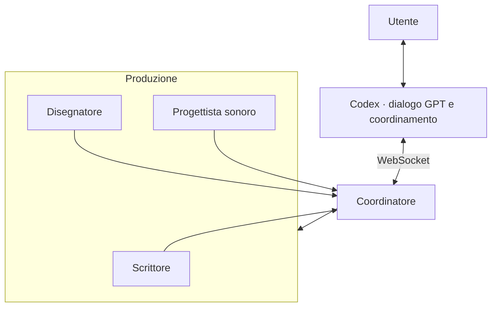
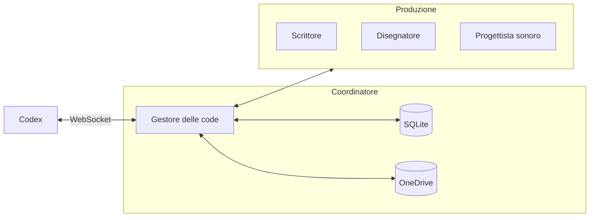
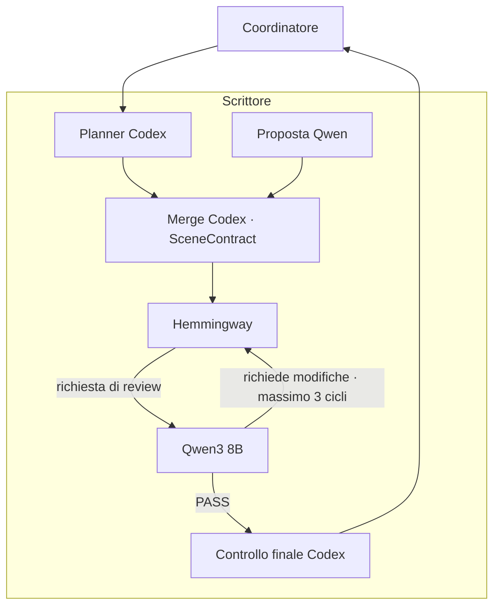
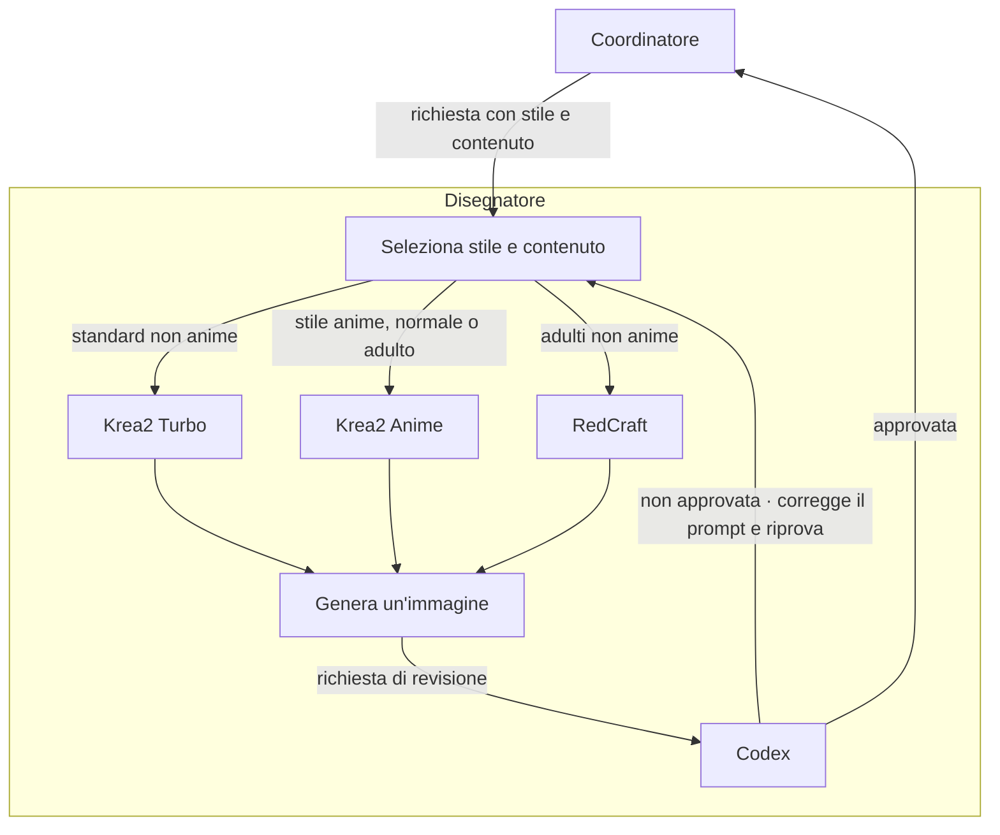
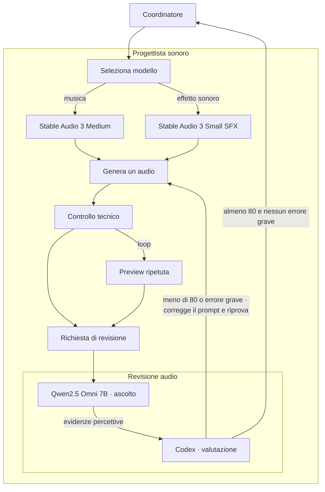
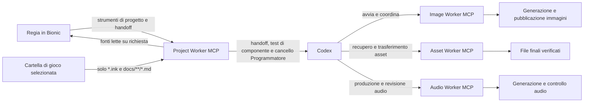

# Estensione delle capacità generative di Codex

Questo progetto estende le capacità generative di Codex tramite un server Tauri con coordinatore persistente, modelli AI locali e strumenti esterni per produrre e validare contenuti e asset, riducendo quando possibile il consumo dei crediti dei servizi online. Il client MCP gira sul PC locale; il server e i motori di generazione possono girare su Shadow o su un altro host. Il progetto non è limitato a uno specifico tipo di contenuto.

## Installazione e configurazione (client e server)

> **Stato:** architettura in sviluppo. Gli eseguibili dell'app saranno compilati dalla CI GitHub: non è necessario installare Rust, Wrangler o gli strumenti di build Tauri per usare le release.

### Client MCP (PC locale)

| Programma | Descrizione | Installazione |
|---|---|---|
| rclone | Scarica gli asset dalla cartella cloud condivisa. | [Download](https://rclone.org/downloads/) |
| Node.js | Esegue il client MCP TypeScript e le CLI AI. | [Download](https://nodejs.org/en/download) |
| Codex CLI | Client AI che controlla i programmi tramite MCP. | `npm install -g @openai/codex` |
| Shadow PC *(opzionale)* | Accesso al PC cloud che ospita il server, se si utilizza Shadow. | [Download ufficiale](https://shadow.tech/) |

**Configurazioni particolari**

**rclone:** esegui `rclone version`, `rclone config` e `rclone listremotes`. Configura l'accesso alla cartella condivisa; il remote può avere un nome diverso da quello del server. Non usare `rclone-sdk` o `rclone rcd` e non pubblicare `rclone.conf`.

**Codex CLI:** avvia `codex` ed effettua l'accesso; l'associazione al server MCP sarà documentata quando implementata.

### Server Tauri (Shadow o altro host)

| Programma | Descrizione | Installazione |
|---|---|---|
| rclone | Pubblica temporaneamente gli asset per i client. | [Download](https://rclone.org/downloads/) |
| Node.js | Esegue le CLI AI e gli eventuali adapter JavaScript/TypeScript. | [Download](https://nodejs.org/en/download) |
| LM Studio | Esegue i modelli AI locali. | [Download](https://lmstudio.ai/download) |
| **`sd-cli.exe`** | Genera le immagini con i modelli locali; backend attuale del Disegnatore. | [stable-diffusion.cpp (release)](https://github.com/leejet/stable-diffusion.cpp/releases) |
| Codex CLI | Coordina e controlla i programmi tramite terminale. | `npm install -g @openai/codex` |
| Gemini CLI | Assistente Gemini quando richiesto. | `npm install -g @google/gemini-cli` |

**Configurazioni particolari**

**rclone:** esegui `rclone config` e `rclone listremotes`; configura l'accesso alla stessa cartella condivisa del client. I file temporanei sono limitati alla cartella dell'app: pulizia prevista dopo 7 giorni, recupero di 500 MiB di spazio aggiuntivo prima degli upload e ripubblicazione dalla cache locale.

**Codex CLI e Gemini CLI:** avvia rispettivamente `codex` e `gemini` per verificare l'accesso. Gemini CLI usa l'account già collegato e la selezione automatica del modello; per richiederla esplicitamente usa `gemini --model auto`. Non configurare una chiave API o fissare un modello senza richiesta dell'utente. Gemini è un reviewer sperimentale, non ancora adottato: Codex sul server resta Coordinatore, possiede gli strumenti MCP e usa Gemini solo per ricevere giudizi strutturati sugli artefatti. Non assegnare strumenti MCP a Gemini. I controlli deterministici e l'approvazione Codex restano indipendenti dalla review Gemini.

**Distribution:** Dedicated GitHub Actions workflows will publish the MCP library, build the Tauri server installers and deploy the Cloudflare relay, selected by the tag prefixes documented below. Release users do not need Rust, Wrangler or the Tauri SDK. Branch CI also retains a Windows debug executable for seven days to support interactive validation; it does not enable release autostart or publish a release. The Tauri/React desktop shell manages a local persistent queue and displays job history. A separate Windows Coordinator process now has a single-instance lock, controlled stop request and login autostart wiring; it does not dispatch production work yet. The desktop includes a system-browser Google sign-in flow, stores Firebase refresh credentials and a stable server identity in the OS credential store, and can create or remove a one-server-per-account Firestore pairing. The Security screen lists and revokes authorized clients. Interactive sign-in and pairing still need verification on Windows. The Firebase project has an empty Standard Firestore database in `europe-west3` with restrictive rules; no pairing data has been written. Client enrollment, production workers, client library, authenticated relay and release workflows remain to be completed. Native builds and Rust tests run in GitHub Actions. The Firebase project and desktop web app are registered, and the Google Sign-In provider is enabled.

### Release automation

Release publishing is selected by the prefix of a pushed Git tag: `lib-v<version>` publishes the MCP client/library to npm; `server-v<version>` publishes the Tauri server installers as a GitHub Release; `relay-v<version>` selects the dedicated Cloudflare relay deployment workflow. Components have independent versions. Branch pushes and pull requests run checks without publishing. Relay deployment remains blocked until authentication, authorization and relay security gates pass.

Codex is authorized to create as many releases and prereleases as needed without requesting approval for each version. Version numbers may be consumed or skipped. The exact preparation, tagging, CI inspection and publication verification procedure is documented in [AGENTS.md](AGENTS.md#releases-and-github-actions), including use of the connected `@github` tools. These workflows are planned and are not implemented yet; a tag alone cannot currently publish the new components.

Firebase project `shadow-controller-20261103` (display name: **Shadow Controller**) was created on 2026-11-03 without linking a billing account. The project has Google sign-in enabled and a Firestore account/server-pairing implementation; live sign-in, pairing, client authorization and the F1 security gate remain unverified.

Gli altri motori di generazione di immagini, video e audio (tra cui `audio.cpp`, ComfyUI e InvokeAI) saranno aggiunti alla tabella quando saranno confermati gli adapter e le modalità di installazione.

---

## Hardware e ambiente

Il progetto usa hardware di seconda mano e comprende Shadow PC nell’ambiente di lavoro. L’architettura assegna il progetto di gioco e i suoi file al **PC locale** e i modelli locali con i relativi worker al **PC cloud**. I test eseguiti finora sono stati effettuati su un solo host Windows con GPU NVIDIA RTX A4500: l’esecuzione distribuita e il passaggio automatico dei job tra le due macchine non sono ancora stati verificati.

## Architettura generale

**Decisione architetturale:** il ruolo Regia è eliminato. Codex è l'unica interfaccia conversazionale; il Coordinatore gestisce le code. I modelli, i profili Bionic, i prompt, gli adapter e le configurazioni dedicati esclusivamente alla Regia saranno rimossi in una successiva fase di pulizia, previa verifica delle dipendenze condivise. Non rimuovere componenti ancora utilizzati da altri worker.

L'utente dialoga con Codex, che invia i lavori al Coordinatore attraverso il client MCP e la connessione WebSocket. Il Coordinatore gestisce le code e distribuisce le attività ai worker di produzione; i risultati ritornano a Codex.

### Coordinatore

**Codex** è l'interfaccia conversazionale dell'utente e comunica tramite il client MCP e il relay WebSocket con il **Gestore delle code**, eseguito dal Coordinatore Rust sul server. Il gestore registra ogni richiesta, pianifica i job, controlla le risorse disponibili, gestisce annullamenti, tentativi e recupero dopo i riavvii e restituisce a Codex stato e risultati.

**SQLite locale sul server** è il database autorevole per le richieste: conserva identificativi, stati, priorità, tentativi, errori e riferimenti agli asset. Non richiede un servizio database esterno.

**OneDrive** è mostrato come spazio per i file temporanei, **non come database**: il trasferimento avviene tramite rclone e il provider può essere sostituito con qualsiasi altro supportato. Il Coordinatore non usa OneDrive per la gestione delle code. Il core persistente dei job è implementato; gli adapter di esecuzione, il processo indipendente e le integrazioni illustrate restano da collegare.

### Scrittore

Prima della scrittura, Codex e Qwen preparano proposte di piano in parallelo. Codex le unisce in un `SceneContract` strutturato con fatti canonici, conoscenze dei personaggi, beat, divieti e condizione finale. La validazione controlla schema e POV; se il contratto non è valido, si tenta una sola correzione circoscritta e il flusso si ferma prima del Writer se resta invalido. Il contratto accompagna la bozza e viene ricontrollato nella review finale; non aggiorna il canone. Gemini è un candidato sperimentale per la review narrativa e degli altri artefatti generati, da confrontare con i reviewer attuali; non scrive proposte di piano e non riceve strumenti MCP. Codex coordina il flusso e resta responsabile dei tool, degli handoff e delle decisioni sul canone: il Writer trasforma il contratto in prosa, il Narrative Reviewer verifica la scena e Codex controlla l’esito prima dell’handback.

Lo Scrittore produce la prima bozza narrativa in inglese a partire dal brief approvato, dal contratto di scena e dalle informazioni canoniche. Il modello Writer operativo resta **Hemmingway 1 Abliterated Extreme**; è stato aggiunto il profilo **MS3.2 PaintedFantasy v4.1 24B Q4_K_M** come candidato per prove isolate, senza cambiare il modello operativo. Il profilo usa temperatura 0,8, top-p 0,95, min-p 0,05, repeat penalty 1,02 e contesto 8192. Le impostazioni di campionamento seguono i valori consigliati nella [scheda PaintedFantasy v4.1](https://huggingface.co/zerofata/MS3.2-PaintedFantasy-v4.1-24B); il percorso GGUF installato è `mradermacher/MS3.2-PaintedFantasy-v4.1-24B-GGUF/MS3.2-PaintedFantasy-v4.1-24B.Q4_K_M.gguf`.

Il ciclo Writer → Narrative Reviewer può richiedere correzioni mirate; il Reviewer narrativo attualmente configurato è **Qwen3 8B Narrative Reviewer**. Gemini verrà valutato come possibile reviewer, senza presumere che sia efficace né cambiare la pipeline sulla base di un singolo giudizio. Dopo l'esito del reviewer operativo, Codex esegue un controllo finale e può correggere direttamente problemi locali di formato o formulazione, preservando la storia già approvata. La configurazione limita le modifiche finali per evitare riscritture estese.

Il confronto dei test Writer isolati è in [Confronto dei modelli di narrazione](docs/CONFRONTO-MODELLI-NARRAZIONE.md); il [rapporto storico dei test narrativi completi](docs/CONFRONTO-MODELLI-DI-NARRAZIONE.md) conserva i campioni e i risultati precedenti.

### Disegnatore

Il Disegnatore prepara le immagini coerenti con personaggi, ambienti e momenti narrativi. Il generatore è **`sd-cli.exe`**. La selezione combina stile e contenuto: **Krea2 Turbo** è il profilo standard non anime; **RedCraft v3.0** è il profilo adulto non anime; se il Project File indica lo stile anime, **Krea2 Anime v2.0** prevale sul tipo di contenuto e viene usato sia per immagini normali sia per immagini adulte. Riferimenti: [Krea2 Anime v2.0](https://civitai.red/models/2908999/krea2-anime?modelVersionId=3357716) e [RedCraft v3.0](https://civitai.red/models/958009/redcraft-or-or-hybrid-h3-and-krea2t-and-qw21-fixed-w6a8?modelVersionId=3139241).

Il LoKR SNOFS è stato rimosso e non rientra più nei profili né nei test pianificati. Le prove precedenti nel percorso `sd-cli` non applicavano i pesi (0/768 tensori) e il sampling falliva; questo esito storico non costituisce una valutazione della qualità visiva del modello.

Il Coordinatore riceve la richiesta con le indicazioni di stile e contenuto (standard, anime o adulto) e la inoltra direttamente alla selezione del modello. Il Worker genera l'immagine e Codex esamina i risultati. Un’immagine viene accettata se la valutazione visiva raggiunge la soglia prevista e non rileva errori visivi gravi; altrimenti il processo può correggere il prompt e riprovare entro il limite configurato. Il controller visivo separato non è attualmente installato: il Coordinatore prepara direttamente la richiesta visiva. Dopo l'approvazione il risultato torna al Coordinatore, senza una fase di pubblicazione rclone interna al Disegnatore. Gemini è un reviewer candidato: il confronto con Codex deve verificare la qualità del giudizio prima di qualsiasi modifica al reviewer operativo. Codex conserva il controllo degli strumenti MCP e degli handoff. È inoltre prevista una valutazione separata di InvokeAI come possibile sostituto di sd-cli.exe e di un componente opzionale per ritocchi post-generazione, a partire dalla rimozione dello sfondo; vedere gli handoff 04 e 05.

`generate_image` consente di specificare `steps`, `cfg_scale`, `style` e LoRA registrate facoltative; il server impedisce sovrascritture in staging e considera fallita una generazione se la CLI dichiara che non ha applicato alcun tensore richiesto. Gli adapter restano esclusi dai default e sono bloccati per la produzione finché il relativo stato nel catalogo non è `ready`. I default sono Krea2 Turbo 8 passi/CFG 1, RedCraft 12/CFG 1 e Krea2 Anime 12/CFG 1. Width, height, seed, percorso modello, encoder, VAE, adapter e parametri effettivi vengono registrati nel risultato. La nuova prova della LoRA `flaccid_erect_krea2_loraholic` ha applicato `512 / 512` tensori su RedCraft con i pesi +3 e -3. Il candidato +3 ha ottenuto 78/100 senza errore grave, sotto la soglia di accettazione; la valutazione del candidato -3 è stata rifiutata. La compatibilità tecnica è quindi confermata, ma la convalida visiva non è completa e l’adapter resta escluso dalla produzione. Dettagli nel [catalogo LoRA](docs/IMAGE-LORAS.md) e nel [manifest](production-tests/components/designer_lora_20261025093323_ee11c97f74/manifest.json). Il confronto modelli è in [Rapporto confronto modelli immagini](production-tests/DESIGNER-MODEL-COMPARISON-2026-10-24.md). Tutti i candidati di test restano in staging e non vengono pubblicati.

Nel confronto componenti senza LoRA del 25 ottobre 2026 (`node project-worker/mcp/orchestration/image-three-krea2-component-test.mjs`), Krea2 Turbo e RedCraft hanno ottenuto entrambi 86/100 senza errori gravi; Krea2 Anime v2.0 ha ottenuto 48/100 con un errore grave per inquadratura troppo stretta e ambiente non privato. Tutti e tre hanno generato PNG 1024×1024 e sono stati revisionati; nessun candidato è stato finalizzato o pubblicato. Il run, i seed, gli hash, i percorsi dei modelli/encoder/VAE e le chiamate MCP sono registrati in `production-tests/components/designer_krea2_20261025090850_2110272945/manifest.json`. Nel test è stato corretto il flag di caricamento `sd-cli` per i checkpoint Krea2 autonomi (`--diffusion-model`) rispetto al checkpoint RedCraft (`-m`).

### Progettista sonoro

Il Progettista sonoro prepara musica ed effetti coerenti con ciò che accade nella storia. La generazione usa **audio.cpp v0.9.0 Vulkan** con **Stable Audio 3 Medium Q8** per la musica e **Stable Audio 3 Small SFX Q8** per gli effetti.

La richiesta al Coordinatore specifica ogni cue: categoria (musica o effetto), comportamento loop, descrizione, trigger e condizione di stop. Il Coordinatore gestisce l'eventuale riutilizzo di asset già approvati prima di chiamare il Progettista sonoro; quando serve una nuova generazione, invia direttamente la richiesta a Seleziona modello.

La revisione percettiva usa **Qwen2.5 Omni 7B Q4_K_M** con il projector audio incluso nel download LM Studio. Un profilo Bionic specifico del modello contiene il system prompt, che chiede osservazioni verificabili in JSON e non formula un’approvazione. Il runtime di prova è **llama.cpp v0.6.0-dev, build 11560, Vulkan**, nella cartella `C:\Users\Shadow\.lmstudio\audio\llama.cpp\b11560-vulkan`.

Il test da terminale con un breve chime sintetico ha riconosciuto categoria ed elementi descritti, restituito JSON valido, nessun difetto e il flag `loop=false`. È un test di funzionamento dell’ingresso audio e del prompt, non una valutazione della qualità di suoni musicali reali. llama.cpp segnala che l’ingresso audio è sperimentale.

Codex non riceve direttamente il WAV tramite il percorso CLI usato per la revisione delle immagini. Il componente di revisione avvia perciò Qwen2.5 Omni localmente e restituisce un rapporto percettivo in JSON; Codex confronta quel rapporto e i controlli tecnici con il cue, assegna il punteggio e decide se approvare o correggere il prompt. Un cue viene finalizzato soltanto con almeno 80 punti, nessun errore grave e un rapporto d’ascolto interpretabile. Il limite è di tre generazioni per cue. Per i loop viene ascoltata anche un’anteprima ripetuta senza crossfade artificiale; una singola passata non certifica la continuità del loop.

Prima di generare, il Coordinatore cerca gli audio già finalizzati nello spazio del progetto e ne confronta manifest, categoria e comportamento loop con il cue. Se trova un asset adatto, lo riusa e ne verifica hash e manifest. I nuovi WAV approvati vengono finalizzati in `C:\AI\assets\<PROJECT_ID>\Audio\Music` o `C:\AI\assets\<PROJECT_ID>\Audio\SoundEffects`, e successivamente trasferiti, quando necessario, dal Coordinatore tramite rclone. Il manifest conserva hash, rapporto percettivo e decisione Codex; lo stato di trasferimento è responsabilità del Coordinatore.

È prevista una valutazione di **Gemini come possibile reviewer audio** a confronto con Qwen2.5 Omni + Codex, senza modificare la revisione operativa. Occorre verificare supporto audio effettivo nella modalità CLI scelta, qualità del giudizio su musica, SFX, loop, latenza, costi, limiti e rifiuti. Gemini non usa MCP: Codex coordina la review, conserva i controlli tecnici e decide l'esito. Vedere l'handoff 06.

Il confronto dei modelli è documentato in [Confronto dei modelli audio](docs/CONFRONTO-MODELLI-AUDIO.md) e [Confronto dei tre modelli Writer](docs/CONFRONTO-MODELLI-NARRAZIONE.md). La prova completa degli strumenti Audio Worker, dell’ascolto Qwen e della decisione Codex è riportata in [Test del flusso Audio Worker](RAPPORTO-TEST-AUDIO-WORKER.md). Il runner del Coordinatore è predisposto per la fase audio; le precedenti prove legate a Bionic restano materiale storico e non fanno parte del nuovo flusso.

## PC locale, PC cloud e condivisione dei file

Il sistema separa il **PC locale**, dove l'utente lavora con **Codex CLI** e conserva i propri progetti, dal **server Tauri** sul PC Shadow (o altro host), che esegue il **Coordinatore Rust**, i modelli locali e i worker di produzione. Il client MCP comunica con il server attraverso una connessione **WebSocket** e il relay Cloudflare previsto; il Coordinatore gestisce le richieste e le code persistenti in **SQLite**, distribuisce i job e restituisce stati e risultati a Codex.

Questa è l'**architettura obiettivo**, non un'integrazione remota già completata. I test storici sono stati eseguiti su un singolo host Windows con GPU NVIDIA RTX A4500. Il relay Cloudflare esistente è ancora un bootstrap non operativo: autenticazione, WebSocket, Durable Object e dispatch remoto devono essere implementati.

### Cosa gira su ciascuna macchina

| Sistema | Responsabilità |
|---|---|
| **PC locale (client MCP)** | Codex CLI, Node.js, client MCP e rclone. Il progetto dell'utente e gli asset integrati restano qui; Codex invia richieste e riceve risultati dal Coordinatore. |
| **PC Shadow / server Tauri** | Applicazione Tauri, Coordinatore Rust, **SQLite** per richieste e stato, LM Studio, `sd-cli.exe`, runtime audio e altri worker/CLI AI necessari. Il Coordinatore pianifica le code, gestisce GPU/VRAM, ripartenze e trasferimenti. |
| **Cloudflare** | Relay WebSocket previsto per collegare client e server senza richiedere una connessione in ingresso diretta al PC Shadow. Il servizio non è ancora attivo per il traffico applicativo. |
| **OneDrive (tramite rclone)** | Cartella cloud temporanea condivisa per scambiare file e asset. Non è il database delle richieste e non sostituisce SQLite. Il provider è configurabile tramite rclone. |

### Dove risiedono modelli, richieste e asset

- **Modelli e runtime:** risiedono sul server Shadow. LM Studio esegue i modelli linguistici locali; `sd-cli.exe` resta il generatore di immagini attuale e `audio.cpp` quello audio. I percorsi rilevati nei test precedenti sono indicativi dell'host di prova e non costituiscono un requisito per nuove installazioni.
- **Richieste e code:** il database **SQLite** locale al Coordinatore conserva identificativi delle richieste e dei job, stati, priorità, tentativi, errori e riferimenti agli asset. È il registro autorevole; non si usa OneDrive come coda.
- **Progetti:** i sorgenti e i file dell'utente restano sul PC locale. Non è più previsto un Project File vincolato alla workspace Bionic o un passaggio attraverso Regia.
- **Asset generati:** vengono conservati inizialmente sul server; il Coordinatore decide quando renderli disponibili al client e può mantenere una cache locale per ripubblicarli. I worker non pubblicano autonomamente tramite rclone.

### Trasferimento file con rclone

**rclone** è installato e configurato separatamente sul client e sul server. Entrambi accedono alla stessa cartella temporanea dell'app su **OneDrive**, oppure su un altro provider supportato. Il nome del remote può essere diverso sulle due macchine; `rclone.conf` contiene credenziali e non deve essere inserito nel repository o nei log.

Il **Coordinatore** gestisce gli upload e i riferimenti agli asset; il **client MCP** scarica i file necessari. Il trasferimento avviene solo quando richiesto, non come sincronizzazione continua. La coda e il dispatch restano indipendenti da rclone.

La gestione prevista dei file temporanei comprende pulizia dei file dell'app più vecchi di **7 giorni** all'avvio del server, recupero dello spazio necessario per nuovi upload con un margine di **500 MiB**, e possibilità di ripubblicare asset dalla cache locale. Le cancellazioni devono rimanere strettamente nella cartella temporanea dell'app, senza toccare altri file del provider.

Il trasferimento remoto, la pulizia automatica e il recupero dei job dopo i riavvii sono **funzionalità da implementare e verificare**: non sono garantite dall'attuale configurazione di rclone.

## MCP: strumenti e installazione

Gli MCP sono server reali che espongono strumenti ai modelli e gestiscono i passaggi tra i ruoli. I test di componente usano gli stessi server e contratti in modalità di prova, che registra o simula il passaggio senza avviare la produzione. Il test completo usa i server in modalità reale. I server locali vengono avviati come processi Node.js tramite trasporto standard input/output (stdio), non come servizi web sempre attivi.

### Dove si configurano

Il **Project Worker** è l’MCP collegato a Bionic. Fornisce alla Regia gli strumenti per creare e leggere il Project File, registrare il progetto, associare una cartella di gioco selezionata dall’utente e consultare in sola lettura i sorgenti Ink e i Markdown sotto `docs/`. L’accesso è limitato alle radici Programmer configurate; link simbolici, traversal, altri tipi di file e scritture del gioco sono rifiutati. Il worker può inoltre avviare il Coordinatore, eseguire i passaggi di prova dei test di componente e avviare il Programmatore dopo scelta e conferma separate. È registrato nella configurazione MCP interna di Bionic sotto `C:\Users\Shadow\.lmstudio\apps\bionic\.internal`. Il comando `lms` disponibile in questo PC non offre un sottocomando `mcp`; quindi il ripristino della registrazione si esegue dalle impostazioni MCP dell’app.

Il Project Worker offre due strumenti per il Programmatore: `select_programmer` registra Claude o Codex senza eseguire codice; `start_programmer` accetta solo la selezione pendente e una conferma esplicita separata. Entrambi usano la directory progetto indicata e configurata tra le radici ammesse. Il comando avviato non riceve un override del modello. Se il provider scelto manca, il tool restituisce un errore e non passa all’altro.

I quattro server sono configurati anche per Codex in `C:\Users\Shadow\.codex\config.toml`: Project Worker, Image Worker, Asset Worker e Audio Worker. Il Coordinatore abilita i soli strumenti Audio Worker necessari nella fase `audio_cue_production`: ricerca asset, generazione, ispezione, anteprima loop, ascolto locale, finalizzazione e pubblicazione. La fase audio è separata da Writer e Disegnatore e non richiede Claude.

Per le procedure e i comandi di test da terminale, consultare [AGENTS.md](AGENTS.md). I rapporti dei test storici rimangono disponibili nella documentazione e in `production-tests/`; alcune procedure di AGENTS.md descrivono ancora il flusso precedente e dovranno essere aggiornate alla nuova architettura.
