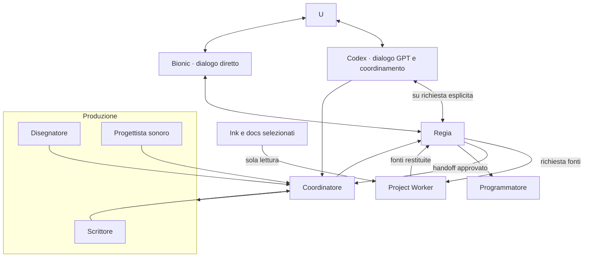
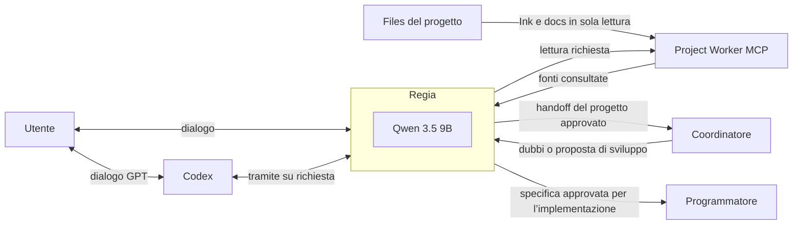
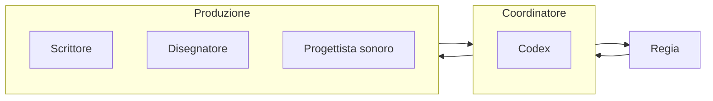
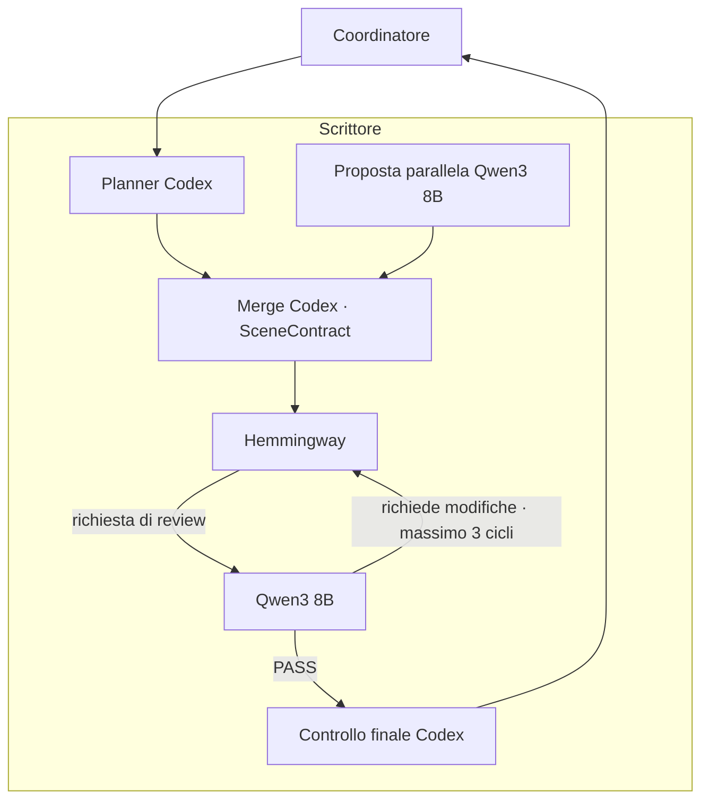
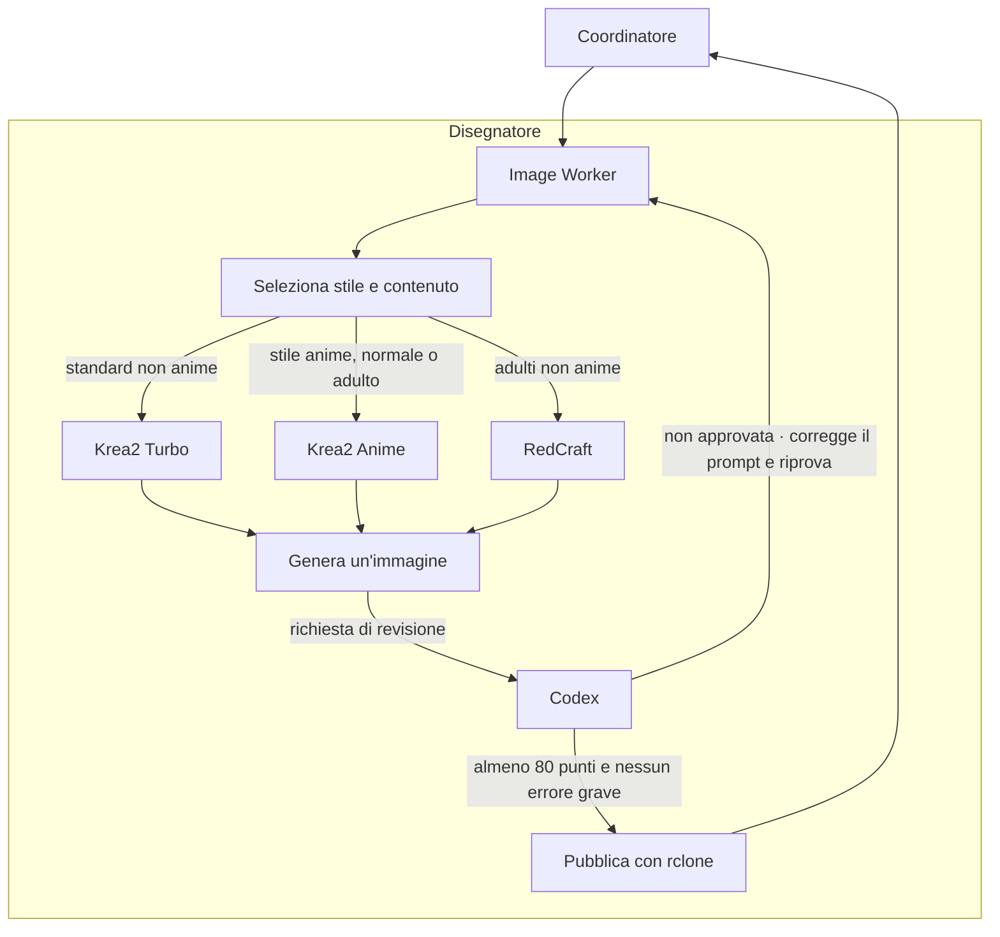
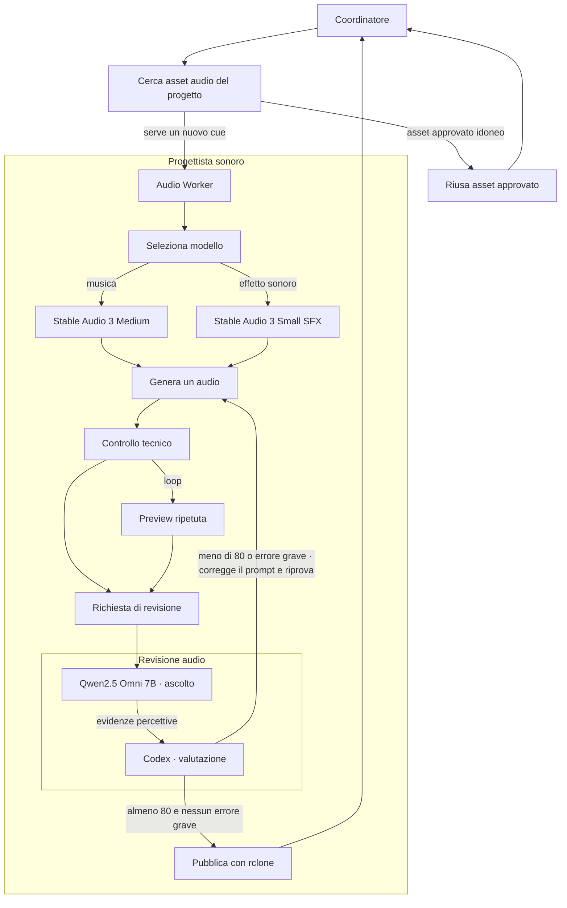
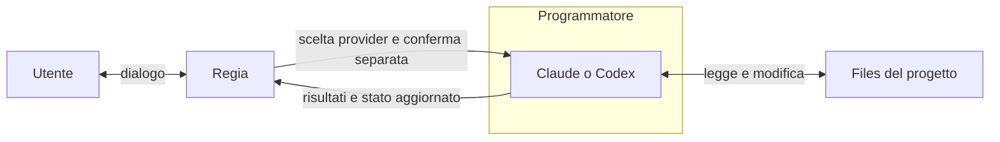
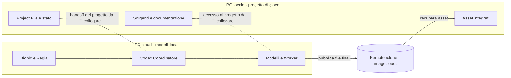
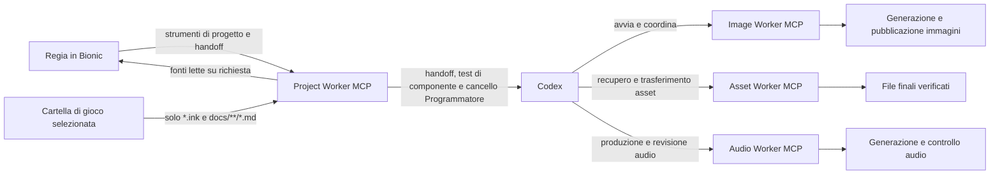
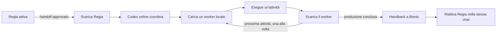

# Architettura locale e cloud per la creazione di visual novel

Il progetto offre due punti d’ingresso: Codex e LM Studio con Bionic. In Codex l’utente dialoga normalmente con GPT; quando chiede esplicitamente di parlare con la Regia, Codex inoltra i messaggi al modello locale e ne presenta le risposte attribuite. In Bionic l’utente conversa direttamente con la Regia. Entrambi i percorsi usano il Project File canonico e gli stessi worker. L’obiettivo generale resta generare la prima bozza di una visual novel; la modifica di visual novel esistenti è un obiettivo futuro.

Il sistema non è stato progettato per lavorare soltanto in locale. I modelli online possono offrire capacità di ragionamento e coordinamento nettamente superiori; possono dirigere i passaggi tra i worker e stabilire quale processo locale utilizzi la VRAM in un dato momento. Quando un modello locale non raggiunge la qualità o le capacità richieste, il coordinamento può ricorrere al cloud. I modelli locali restano utili per ridurre il consumo dei crediti Codex, la dipendenza dai servizi online e i limiti sui contenuti imposti da singoli modelli cloud, secondo le regole applicabili.

## Installazione e configurazione (client e server)

> **Stato:** architettura in sviluppo. Installa solo i programmi necessari al ruolo della macchina; gli adapter opzionali saranno documentati quando definiti.

### Client MCP (PC locale)

| Programma | Descrizione | Installazione |
|---|---|---|
| rclone | Trasferisce gli asset tramite una cartella cloud condivisa. | [Download](https://rclone.org/downloads/) |
| Node.js | Esegue il client MCP TypeScript. | [Download](https://nodejs.org/en/download) |
| Codex CLI *(opzionale)* | Client AI che può utilizzare gli strumenti MCP. | `npm install -g @openai/codex` |

**Configurazioni particolari**

**rclone:** esegui `rclone version`, `rclone config` e `rclone listremotes`. Configura un provider supportato con accesso alla cartella condivisa. Il nome del remote può essere diverso da quello del server. Non servono `rclone-sdk` o `rclone rcd`; non sovrascrivere la configurazione esistente né pubblicare `rclone.conf`.

### Server Tauri (Shadow o altro host)

| Programma | Descrizione | Installazione |
|---|---|---|
| rclone | Pubblica temporaneamente gli asset per i client. | [Download](https://rclone.org/downloads/) |
| LM Studio | Esegue i modelli linguistici locali. | [Download](https://lmstudio.ai/download) |
| Rust | Compila il coordinatore e l'app Tauri. | [Installazione](https://rustup.rs/) |
| Node.js | Compila l'interfaccia Tauri. | [Download](https://nodejs.org/en/download) |
| Cloudflare Workers *(servizio)* | Relay remoto, distribuito dal repository. | [Dashboard](https://dash.cloudflare.com/) |

**Configurazioni particolari**

**rclone:** configura il provider con `rclone config` e verifica con `rclone listremotes`; il remote deve accedere alla stessa cartella condivisa del client, anche se ha un nome diverso.

**Asset temporanei (funzionalità prevista):** usa solo la cartella cloud dedicata all'app; elimina all'avvio i file più vecchi di 7 giorni e, se necessario, libera spazio per il nuovo upload più 500 MiB. Ripubblica dalla cache locale quando disponibile. Gli asset definitivi restano sul client.

**Cloudflare:** il Worker `shadow-mcp-relay` esiste, ma WebSocket, Durable Object e autenticazione non sono ancora operativi. Codice e deploy GitHub Actions + Wrangler saranno gestiti in questo repository; Firebase e pairing verranno configurati in seguito.

I motori immagini, video e audio (ad esempio `sd-cli.exe`, `audio.cpp`, ComfyUI e InvokeAI) saranno aggiunti dopo la scelta degli adapter e delle rispettive istruzioni. Firebase verrà configurato successivamente.

---

## Hardware e ambiente

Il progetto usa hardware di seconda mano e comprende Shadow PC nell’ambiente di lavoro. L’architettura assegna il progetto di gioco e i suoi file al **PC locale** e i modelli locali con i relativi worker al **PC cloud**. I test eseguiti finora sono stati effettuati su un solo host Windows con GPU NVIDIA RTX A4500: l’esecuzione distribuita e il passaggio automatico dei job tra le due macchine non sono ancora stati verificati.

## Architettura generale

La conversazione creativa standard può svolgersi con GPT in Codex, che coordina anche la produzione e le risorse locali. In alternativa, la Regia locale può dialogare direttamente in Bionic o, su richiesta esplicita, attraverso Codex come tramite; dopo l’approvazione della fase creativa passa il progetto al Coordinatore Codex. Tutte le decisioni confluiscono nello stesso Project File. Scrittore, Disegnatore e Progettista sonoro preparano i contenuti; i risultati ritornano al punto d’ingresso usato dall’utente. La programmazione richiede una scelta e un’approvazione separate.



### Regia

La Regia locale dialoga con l’utente attraverso Bionic oppure, su richiesta esplicita, attraverso Codex. Il modello locale resta eseguito dal runtime LM Studio: il percorso Codex non richiede l’interfaccia Bionic. Nelle sessioni verificate la Regia è associata a **Qwen 3.5 9B**. Dialoga nella lingua dell’utente e aiuta a definire concept, personaggi, relazioni, ambientazioni, eventi, tono e direzione visiva e sonora.



Prima di proporre una nuova fase, la Regia deve leggere il Project File e la documentazione aggiornata del progetto, comprenderne lo stato e i progressi, e consultare i file e gli asset già disponibili. Questo le permette di conoscere personaggi, relazioni, luoghi e continuità, capire cosa è già stato realizzato e individuare contenuti riutilizzabili, evitando duplicazioni o contraddizioni. Se la documentazione non chiarisce un fatto canonico o lo stato del lavoro, la Regia lo segnala e chiede chiarimenti invece di inventarlo.

Le decisioni canoniche vengono conservate nel Project File Markdown, scritto in inglese per essere utilizzato da tutta la pipeline. Quando ritiene definita una fase, la Regia presenta il piano all’utente e richiede un’approvazione esplicita. Solo dopo l’approvazione passa Project File e contesto operativo al Coordinatore.

Il Project Worker MCP consente alla Regia di associare la cartella di gioco scelta dall’utente e leggere in sola lettura i file Ink e i documenti Markdown sotto `docs/`. Non espone gli altri file del progetto né consente alla Regia di modificarli. Quando propone una modifica, indica le fonti consultate e il cambiamento suggerito e attende l’approvazione; la scrittura del gioco resta al Programmatore dopo il gate separato.

### Coordinatore



Il Coordinatore è Codex, configurato per questo flusso con **Codex 6 Luna Light**, un modello online. Il suo compito è organizzare attività e attese, leggere il Project File, attivare i worker necessari e raccogliere i risultati. Il coordinamento e l’attesa dei processi locali sono attività adatte a questo modello leggero; essendo online, il Coordinatore non occupa la VRAM locale.

Codex governa l’uso della VRAM: fa lavorare un modello locale per volta e ne libera la memoria prima di avviare il successivo. Gestisce gli imprevisti senza cambiare le decisioni creative approvate; se serve una decisione creativa, restituisce il controllo alla conversazione d’origine, in Bionic o in Codex.

Per avviare le funzioni produttive il Coordinatore usa strumenti MCP. I singoli MCP e le loro responsabilità saranno descritti in una sezione dedicata.

A fine produzione, il Coordinatore restituisce un handback persistente con risultati e problemi. Nel percorso Bionic la Regia riprende nella chat originaria; nel percorso Codex il risultato torna alla conversazione Codex e può essere inoltrato alla Regia locale quando il tramite è attivo. Dopo la chiusura del ciclo creativo, il Programmatore è avviabile come attività separata con le approvazioni previste.

### Scrittore



Prima della scrittura, Codex e Qwen3 8B preparano proposte di piano in parallelo. Codex le unisce in un `SceneContract` strutturato con fatti canonici, conoscenze dei personaggi, beat, divieti e condizione finale. La validazione controlla schema e POV; se il contratto non è valido, si tenta una sola correzione circoscritta e il flusso si ferma prima del Writer se resta invalido. Il contratto accompagna la bozza e viene ricontrollato nella review finale; non aggiorna il canone. Codex coordina il flusso e resta responsabile delle decisioni sul canone: il Writer trasforma il contratto in prosa, il Narrative Reviewer verifica la scena e Codex controlla l’esito prima dell’handback.

Lo Scrittore produce la prima bozza narrativa in inglese a partire dal brief approvato, dal contratto di scena e dalle informazioni canoniche. Il modello Writer operativo resta **Hemmingway 1 Abliterated Extreme**; è stato aggiunto il profilo **MS3.2 PaintedFantasy v4.1 24B Q4_K_M** come candidato per prove isolate, senza cambiare il modello operativo. Il profilo usa temperatura 0,8, top-p 0,95, min-p 0,05, repeat penalty 1,02 e contesto 8192. Le impostazioni di campionamento seguono i valori consigliati nella [scheda PaintedFantasy v4.1](https://huggingface.co/zerofata/MS3.2-PaintedFantasy-v4.1-24B); il percorso GGUF installato è `mradermacher/MS3.2-PaintedFantasy-v4.1-24B-GGUF/MS3.2-PaintedFantasy-v4.1-24B.Q4_K_M.gguf`.

Il ciclo Writer → Narrative Reviewer può richiedere correzioni mirate; il Reviewer narrativo attualmente configurato è **Qwen3 8B Narrative Reviewer**. Dopo il suo esito, Codex esegue un controllo finale e può correggere direttamente problemi locali di formato o formulazione, preservando la storia già approvata. La configurazione limita le modifiche finali per evitare riscritture estese.

Il confronto dei test Writer isolati è in [Confronto dei modelli di narrazione](docs/CONFRONTO-MODELLI-NARRAZIONE.md); il [rapporto storico dei test narrativi completi](docs/CONFRONTO-MODELLI-DI-NARRAZIONE.md) conserva i campioni e i risultati precedenti.

### Disegnatore



Il Disegnatore prepara le immagini coerenti con personaggi, ambienti e momenti narrativi. Il generatore è **`sd-cli.exe`**. La selezione combina stile e contenuto: **Krea2 Turbo** è il profilo standard non anime; **RedCraft v3.0** è il profilo adulto non anime; se il Project File indica lo stile anime, **Krea2 Anime v2.0** prevale sul tipo di contenuto e viene usato sia per immagini normali sia per immagini adulte. Riferimenti: [Krea2 Anime v2.0](https://civitai.red/models/2908999/krea2-anime?modelVersionId=3357716) e [RedCraft v3.0](https://civitai.red/models/958009/redcraft-or-or-hybrid-h3-and-krea2t-and-qw21-fixed-w6a8?modelVersionId=3139241).

Il LoKR SNOFS è stato rimosso e non rientra più nei profili né nei test pianificati. Le prove precedenti nel percorso `sd-cli` non applicavano i pesi (0/768 tensori) e il sampling falliva; questo esito storico non costituisce una valutazione della qualità visiva del modello.

Codex definisce il prompt visivo, il Worker genera le immagini e Codex esamina i risultati. Un’immagine viene accettata se la valutazione visiva raggiunge la soglia prevista e non rileva errori visivi gravi; altrimenti il processo può correggere il prompt e riprovare entro il limite configurato. Il controller visivo separato non è attualmente installato: il Coordinatore prepara direttamente la richiesta visiva.

`generate_image` consente di specificare `steps`, `cfg_scale`, `style` e LoRA registrate facoltative; il server impedisce sovrascritture in staging e considera fallita una generazione se la CLI dichiara che non ha applicato alcun tensore richiesto. Gli adapter restano esclusi dai default e sono bloccati per la produzione finché il relativo stato nel catalogo non è `ready`. I default sono Krea2 Turbo 8 passi/CFG 1, RedCraft 12/CFG 1 e Krea2 Anime 12/CFG 1. Width, height, seed, percorso modello, encoder, VAE, adapter e parametri effettivi vengono registrati nel risultato. La nuova prova della LoRA `flaccid_erect_krea2_loraholic` ha applicato `512 / 512` tensori su RedCraft con i pesi +3 e -3. Il candidato +3 ha ottenuto 78/100 senza errore grave, sotto la soglia di accettazione; la valutazione del candidato -3 è stata rifiutata. La compatibilità tecnica è quindi confermata, ma la convalida visiva non è completa e l’adapter resta escluso dalla produzione. Dettagli nel [catalogo LoRA](docs/IMAGE-LORAS.md) e nel [manifest](production-tests/components/designer_lora_20261025093323_ee11c97f74/manifest.json). Il confronto modelli è in [Rapporto confronto modelli immagini](production-tests/DESIGNER-MODEL-COMPARISON-2026-10-24.md). Tutti i candidati di test restano in staging e non vengono pubblicati.

Nel confronto componenti senza LoRA del 25 ottobre 2026 (`node project-worker/mcp/orchestration/image-three-krea2-component-test.mjs`), Krea2 Turbo e RedCraft hanno ottenuto entrambi 86/100 senza errori gravi; Krea2 Anime v2.0 ha ottenuto 48/100 con un errore grave per inquadratura troppo stretta e ambiente non privato. Tutti e tre hanno generato PNG 1024×1024 e sono stati revisionati; nessun candidato è stato finalizzato o pubblicato. Il run, i seed, gli hash, i percorsi dei modelli/encoder/VAE e le chiamate MCP sono registrati in `production-tests/components/designer_krea2_20261025090850_2110272945/manifest.json`. Nel test è stato corretto il flag di caricamento `sd-cli` per i checkpoint Krea2 autonomi (`--diffusion-model`) rispetto al checkpoint RedCraft (`-m`).

### Progettista sonoro



Il Progettista sonoro prepara musica ed effetti coerenti con ciò che accade nella storia. La generazione usa **audio.cpp v0.9.0 Vulkan** con **Stable Audio 3 Medium Q8** per la musica e **Stable Audio 3 Small SFX Q8** per gli effetti.

Regia specifica nel Project File ogni cue: categoria (musica o effetto), comportamento loop, descrizione, trigger e condizione di stop. Prima di generare, il Coordinatore cerca asset audio già presenti nel progetto e li riusa quando sono adatti; altrimenti seleziona il generatore coerente con la categoria.

La revisione percettiva usa **Qwen2.5 Omni 7B Q4_K_M** con il projector audio incluso nel download LM Studio. Un profilo Bionic specifico del modello contiene il system prompt, che chiede osservazioni verificabili in JSON e non formula un’approvazione. Il runtime di prova è **llama.cpp v0.6.0-dev, build 11560, Vulkan**, nella cartella `C:\Users\Shadow\.lmstudio\audio\llama.cpp\b11560-vulkan`.

Il test da terminale con un breve chime sintetico ha riconosciuto categoria ed elementi descritti, restituito JSON valido, nessun difetto e il flag `loop=false`. È un test di funzionamento dell’ingresso audio e del prompt, non una valutazione della qualità di suoni musicali reali. llama.cpp segnala che l’ingresso audio è sperimentale.

Codex non riceve direttamente il WAV tramite il percorso CLI usato per la revisione delle immagini. L’Audio Worker avvia perciò Qwen2.5 Omni localmente e restituisce un rapporto percettivo in JSON; Codex confronta quel rapporto e i controlli tecnici con il cue, assegna il punteggio e decide se approvare o correggere il prompt. Un cue viene finalizzato soltanto con almeno 80 punti, nessun errore grave e un rapporto d’ascolto interpretabile. Il limite è di tre generazioni per cue. Per i loop viene ascoltata anche un’anteprima ripetuta senza crossfade artificiale; una singola passata non certifica la continuità del loop.

Prima di generare, il Coordinatore cerca gli audio già finalizzati nello spazio del progetto e ne confronta manifest, categoria e comportamento loop con il cue. Se trova un asset adatto, lo riusa e ne verifica hash e manifest. I nuovi WAV approvati vengono finalizzati in `C:\AI\assets\<PROJECT_ID>\Audio\Music` o `C:\AI\assets\<PROJECT_ID>\Audio\SoundEffects`, poi pubblicati in percorsi distinti tramite rclone. Il manifest conserva hash, rapporto percettivo, decisione Codex e stato di pubblicazione.

Il confronto dei modelli è documentato in [Confronto dei modelli audio](docs/CONFRONTO-MODELLI-AUDIO.md) e [Confronto dei tre modelli Writer](docs/CONFRONTO-MODELLI-NARRAZIONE.md). La prova completa degli strumenti Audio Worker, dell’ascolto Qwen e della decisione Codex è riportata in [Test del flusso Audio Worker](RAPPORTO-TEST-AUDIO-WORKER.md). Il runner del Coordinatore è predisposto per la fase audio; l’handoff Bionic non è stato ripetuto mentre il Project File canonico aveva un handback narrativo pendente.

### Programmatore



Il Programmatore è il ruolo che **modifica concretamente il progetto software**: interviene sui file sorgente, integra scene e asset, implementa i comportamenti interattivi e verifica il risultato nel progetto. Codex gli consegna il Project File, la documentazione pertinente, i contenuti approvati, gli asset riutilizzabili e le istruzioni tecniche. Codex coordina il passaggio; non sostituisce il Programmatore nell’editing del progetto.

Al termine del ciclo creativo e produttivo, Regia chiede all’utente se implementerà Claude o Codex. Dopo aver registrato la scelta, chiede una conferma esplicita separata prima di avviare l’implementazione tramite il Project Worker MCP. Il provider selezionato usa il proprio modello predefinito; se non è installato o autenticato, il passaggio si ferma e Regia informa l’utente senza cambiare provider automaticamente. Il Programmatore opera direttamente sui file del progetto e resta separato dalla conversazione creativa in LM Studio/Bionic.

## PC locale, PC cloud e condivisione dei file

Il **PC locale** conserva il progetto di gioco: sorgenti, documentazione, Project File, stato e asset integrati. Il **PC cloud** ospita i modelli locali e i worker che li eseguono, così la generazione usa le risorse di quella macchina. Il Coordinatore online assegna il lavoro e governa l’uso della VRAM del PC cloud.

Questa è la suddivisione architetturale desiderata. Le verifiche disponibili sono state svolte su un solo host Windows con RTX A4500; non provano ancora un’esecuzione distribuita né un servizio che invii job al PC cloud. La condivisione file già presente usa rclone e non costituisce, da sola, una coda o un sistema di dispatch.



### Cosa gira su ciascuna macchina

| Sistema | Stato e responsabilità attuali |
|---|---|
| **PC locale** | Destinazione canonica del progetto di gioco: sorgenti, documentazione, Project File, stato e asset integrati. Il flusso deve poter continuare anche quando il PC cloud è spento, fermando o accodando in modo esplicito la produzione che dipende dai modelli. |
| **PC cloud** | Destinazione dei modelli locali e dei worker di generazione, con GPU e VRAM per scrittura, immagini e audio. Il dispatch remoto, il controllo di disponibilità e l’installazione completa dei worker non sono ancora stati verificati tra due macchine. |
| **Host di test verificato** | I test documentati sono stati eseguiti su un solo host Windows con NVIDIA RTX A4500. Questo dato descrive l’ambiente di prova e non cambia la destinazione architetturale del progetto e dei modelli. |

La GPU, i modelli e i percorsi del PC cloud devono essere verificati sulla macchina effettivamente configurata. rclone trasferisce i file previsti, ma non installa modelli e non avvia da solo la generazione.

### Dove risiedono modelli, progetti e asset

| Dati o programmi | Destinazione architetturale | Note |
|---|---|---|
| Modelli linguistici LM Studio | `C:\Users\Shadow\.lmstudio\models` | Regia Qwen 3.5 9B; Writer Hemmingway 1 Abliterated Extreme; Narrative Reviewer Qwen3 8B. Sono modelli locali di LM Studio. |
| Checkpoint immagini | `C:\AI\image-worker\models` | `krea2_turbo_fp8_scaled.safetensors` (standard), `redcraftREDMIXHybridA2A_30Krea2.safetensors` (adulto non anime) e `krea2Anime_v20_fp8.safetensors` (anime, qualunque rating). Il LoKR SNOFS è stato rimosso e non è più installato né previsto nel flusso immagini. |
| Encoder e VAE immagini | `C:\Users\Shadow\AppData\Local\Comfy-Desktop\ComfyUI-Shared\models` | `text_encoders\qwen3vl_4b_fp8_scaled.safetensors` e `vae\qwen_image_vae.safetensors`, usati da `sd-cli`; questo percorso contiene solo i componenti condivisi e non implica l’uso di ComfyUI come runtime. Se la cartella condivisa viene rimossa, questi due file dovranno essere ricollocati e aggiornati nella configurazione del Worker. |
| Eseguibile Image Worker | `C:\Users\Shadow\.lmstudio\image-worker\bin\sd-cli.exe` | Il server MCP risiede in `C:\Users\Shadow\.lmstudio\image-worker\mcp`. |
| Modelli audio | `C:\AI\audio-worker\models\audio.cpp` | Stable Audio 3 Medium Q8 e Stable Audio 3 Small SFX Q8. |
| Runtime audio.cpp | `C:\Users\Shadow\.lmstudio\audio\audio.cpp\v0.9.0-vulkan` | Il server MCP è in `C:\Users\Shadow\.lmstudio\audio\mcp`. |
| Modello per l’ascolto audio | `C:\Users\Shadow\.lmstudio\models\ggml-org\Qwen2.5-Omni-7B-GGUF` | Qwen2.5 Omni 7B Q4_K_M più projector F16; profilo Bionic nella cartella interna `user-concrete-model-default-config`. |
| Runtime per il test audio multimodale | `C:\Users\Shadow\.lmstudio\audio\llama.cpp\b11560-vulkan` | Build 11560; il CLI multimodale è usato per il test da terminale. |
| Project File e stato operativo | Workspace del progetto Bionic corrente: `C:\Users\Shadow\.lmstudio\apps\bionic\projects\<BIONIC_PROJECT_ID>\workspace` | Project Worker scrive e legge qui; lo stato di handoff è in `.orchestration`. |
| Asset finali locali | `C:\AI\assets\<PROJECT_ID>` | Organizzati per progetto; audio separato in `Audio\SoundEffects` e `Audio\Music`. |

I percorsi sopra sono quelli rilevati durante i test sull’host Windows verificato. Nell’architettura a due macchine i modelli appartengono al PC cloud; il trasferimento dei soli asset via rclone non replica il catalogo dei modelli.

Project File e stato di orchestrazione sono collocati nella workspace del progetto Bionic attivo. Il Project Worker riceve questa radice tramite `BIONIC_PROJECTS_DIR`; quando si passa a un diverso progetto Bionic, la radice va associata al relativo workspace prima di usare i tool. Dopo ogni scrittura Regia rilegge il documento e ne verifica hash e revisione prima di chiedere approvazione o fare handoff.

### Trasferimento file con rclone

Il trasferimento dei file è gestito da **rclone**. Il remote già configurato si chiama `imagecloud:`. Il file di configurazione locale di rclone è sotto `%APPDATA%\rclone\rclone.conf`; contiene credenziali e non va copiato nel repository, nei Project File o nei log. Ogni macchina che trasferisce file deve avere rclone configurato localmente.

Il trasferimento avviene quando il worker chiama rclone: non è una sincronizzazione continua delle cartelle e non costituisce una coda di job remoti.

| Contenuto | Percorso remoto rclone | Direzione e responsabile |
|---|---|---|
| Immagini finali | `imagecloud:ImageWorker/final/` | Image Worker pubblica; Asset Worker scarica la copia finale in `C:\AI\assets\<PROJECT_ID>`. |
| Effetti sonori finali | `imagecloud:AudioWorker/SoundEffects/final/<PROJECT_ID>/` | Destinazione configurata per WAV e manifest; pubblicazione di un prodotto finale non ancora verificata. |
| Musiche finali | `imagecloud:AudioWorker/Music/final/<PROJECT_ID>/` | Destinazione configurata per WAV e manifest; pubblicazione di un prodotto finale non ancora verificata. |

Il codice usa copie esplicite tramite rclone e controlli sul risultato; non viene eseguita una sincronizzazione indiscriminata del remote. La pubblicazione delle immagini verifica la presenza remota; il trasferimento locale usato nella produzione confronta anche l’hash del file. La pubblicazione audio verifica le dimensioni di WAV e manifest. La rimozione di un file remoto non è automatica nel flusso normale.

Quando il PC cloud sarà collegato, potrà scaricare tramite rclone gli input autorizzati e pubblicare i risultati nei percorsi finali previsti. La richiesta del job, l’assegnazione al PC cloud, il controllo che sia online e la gestione dei tentativi sono parti separate da implementare: rclone da solo non le fornisce.

## MCP: strumenti e installazione

Gli MCP sono server reali che espongono strumenti ai modelli e gestiscono i passaggi tra i ruoli. I test di componente usano gli stessi server e contratti in modalità di prova, che registra o simula il passaggio senza avviare la produzione. Il test completo usa i server in modalità reale. I server locali vengono avviati come processi Node.js tramite trasporto standard input/output (stdio), non come servizi web sempre attivi.



### Dove si configurano

Il **Project Worker** è l’MCP collegato a Bionic. Fornisce alla Regia gli strumenti per creare e leggere il Project File, registrare il progetto, associare una cartella di gioco selezionata dall’utente e consultare in sola lettura i sorgenti Ink e i Markdown sotto `docs/`. L’accesso è limitato alle radici Programmer configurate; link simbolici, traversal, altri tipi di file e scritture del gioco sono rifiutati. Il worker può inoltre avviare il Coordinatore, eseguire i passaggi di prova dei test di componente e avviare il Programmatore dopo scelta e conferma separate. È registrato nella configurazione MCP interna di Bionic sotto `C:\Users\Shadow\.lmstudio\apps\bionic\.internal`. Il comando `lms` disponibile in questo PC non offre un sottocomando `mcp`; quindi il ripristino della registrazione si esegue dalle impostazioni MCP dell’app.

Il Project Worker offre due strumenti per il Programmatore: `select_programmer` registra Claude o Codex senza eseguire codice; `start_programmer` accetta solo la selezione pendente e una conferma esplicita separata. Entrambi usano la directory progetto indicata e configurata tra le radici ammesse. Il comando avviato non riceve un override del modello. Se il provider scelto manca, il tool restituisce un errore e non passa all’altro.

I quattro server sono configurati anche per Codex in `C:\Users\Shadow\.codex\config.toml`: Project Worker, Image Worker, Asset Worker e Audio Worker. Il Coordinatore abilita i soli strumenti Audio Worker necessari nella fase `audio_cue_production`: ricerca asset, generazione, ispezione, anteprima loop, ascolto locale, finalizzazione e pubblicazione. La fase audio è separata da Writer e Disegnatore e non richiede Claude.

## Test da terminale

### Conversazione Regia attraverso Codex

In Codex, «fammi parlare con la Regia» attiva il tramite per il progetto selezionato. `start_regia_session` restituisce una sessione persistente; `talk_to_regia` inoltra il messaggio esatto e restituisce la risposta da mostrare come **Regia**. «Torna a Codex» usa `stop_regia_session`: la cronologia resta conservata e un avvio successivo la riprende. `get_regia_session` recupera modalità, ultimo risultato e richieste pendenti dopo un riavvio. Codex non deve inventare risposte della Regia né sostituirne le decisioni creative.

Il modello non dispone di tool diretti in questo trasporto. Può proporre il Project File completo in inglese; Codex lo salva tramite `update_project_file` con hash atteso, poi lo rilegge prima di dichiarare il salvataggio. I risultati del modello non costituiscono approvazioni dell’utente. L’handoff approvato usa `frontend="codex"`, verificando la sessione persistente anziché una chat Bionic. Il percorso `frontend="bionic"` resta quello predefinito e conserva la verifica originale della chat. Anche la produzione avviata da Codex usa i worker esistenti e il ritorno persistente; le approvazioni del Programmatore restano separate.

Le sessioni sono in `.orchestration/regia-relay` accanto al Project File; transcript, errori e proposte non vengono eliminati. Ogni messaggio ha un UUID: una chiamata incerta si recupera con lo stesso UUID e lo stesso testo, senza rigenerare una risposta già salvata. Una richiesta fallita/interrotta resta bloccata finché viene ispezionata e scartata esplicitamente con `discard_regia_turn`. La conversazione ha un limite esplicito di contesto: al raggiungimento occorre consolidare il Project File e richiedere una nuova sessione; la vecchia cronologia resta disponibile. La mutua esclusione con il Coordinatore impedisce sovrapposizioni sulla GPU. Un altro modello già caricato va liberato prima di parlare con Regia; non viene scaricato arbitrariamente dal tramite.

La registrazione Project Worker di Codex è stata allineata alla workspace canonica Bionic corrente tramite il solo valore `BIONIC_PROJECTS_DIR`. È una cartella condivisa, utilizzabile anche con Bionic chiuso. Se si sceglie un altro progetto, entrambi i client devono puntare alla sua radice; non creare copie del Project File. Dopo l’aggiornamento ricollegare Project Worker o aprire una nuova attività Codex per caricare i nuovi tool. Impostare per Project Worker un timeout MCP di almeno 2100 secondi, dato che il caricamento/generazione locale può superare il timeout predefinito.

Da `project-worker/mcp`, la prova dedicata è `npm run test:component:relay`: genera scenario, seed e directory nuovi sotto `production-tests/components`, usa Regia e MCP reali, simula la richiesta del Coordinatore, controlla riavvio/richiesta idempotente e sospensione/ripresa, senza avviare produzione. `npm test` copre anche persistenza, errori e separazione dei percorsi Bionic/Codex con adattatori di test.

Verifica del 24 ottobre 2026: **26 test automatici passati** e prova componente reale `20261024165920360_b7e258f95bf675ce` completata con cronologia ripresa e nessun job produttivo. Il tramite accetta prosa italiana senza riscriverla e usa un contesto di 32768 token; il limite esplicito del transcript evita troncamenti silenziosi. Due errori iniziali (timeout e formato JSON obbligatorio) sono stati corretti conservando le prove fallite. Non è stato eseguito un ciclo produttivo completo dal nuovo ingresso. Dettagli in [Verifica Codex → Regia](production-tests/CODEX-REGIA-RELAY-2026-10-24.md).

Il test di componente usa un input nuovo per ogni esecuzione e mette alla prova un ruolo reale alla volta. Regia, Coordinatore e Scrittore verificano le interazioni senza avviare fasi downstream. Il test Designer genera e revisiona un’immagine candidata in staging. Il test audio usa Stable Audio come modello sotto prova e Codex soltanto come Coordinatore: crea un WAV, lo ispeziona, lo fa ascoltare a Qwen, registra la revisione e, se supera il gate, lo finalizza e pubblica in un percorso locale/remoto univoco del run. Nessun test componente avvia il Programmatore. Il test completo parte da Codex come interlocutore e Coordinatore; usa un Project File e un progetto Pixi’VN/Ink temporanei, gli MCP in modalità reale e controlla i file effettivamente consegnati. Il percorso Regia/Bionic si prova separatamente quando è l’oggetto specifico della verifica.

Nel caso `modify`, `npm create pixi-vn@latest` può avviare automaticamente installazioni npm e inizializzare preset UI: sono passaggi normali dello scaffold temporaneo, quindi il runner li lascia terminare e ne conserva l’output. Cache e prefisso npm globale vanno indirizzati alla directory del run quando supportato. Un errore reale lascia intatti directory parziale e log; non si rilancia lo scaffold nello stesso run.

Da `C:\Users\Shadow\.lmstudio\project-worker\mcp`:

```powershell
npm test
npm run test:component -- --role regia
npm run test:component -- --role regia --regia-case empty
npm run test:component -- --role regia --regia-case modify
npm run test:component -- --role regia --regia-case resume
npm run test:complete -- --root="C:\Users\Shadow\.lmstudio\production-tests\complete\<nuova-cartella>"
```

Verifica Regia del 24 ottobre 2026: `npm test` supera 20 controlli. Il runner legacy `npm run test:component -- --role regia` conserva manifest con seed univoco, output CLI grezzi, errori e traccia MCP; verifica la rilettura del Project File e fornisce al secondo turno brief e risposta precedente. La conversazione di prova richiede italiano e riepilogo canonico inglese. I nuovi casi dedicati verificano rispettivamente dialogo da cartella vuota, lettura autonoma di sorgenti Ink e documenti `docs/` con proposta senza scrittura, e ripresa della stessa sessione dopo restart/sospensione MCP. Nel caso Ink, il runner crea un template Pixi’VN/Ink usa e getta, inserisce documenti fixture e verifica che gli hash dei sorgenti non cambino. Nessun caso avvia produzione o implementazione. Per il test completo l’ingresso standard è Codex: il brief creativo iniziale, il Project File canonico e le approvazioni di prova vengono gestiti dal percorso Codex/Project Worker, senza usare `lms chat` come interfaccia alla Regia.

Se un test completo termina con handback `error`, conserva il manifest e gli output parziali. Dopo aver corretto la causa e verificato che il Project Worker abbia un handback completato, la ripresa esplicita usa lo stesso Project File e registra un nuovo job:

```powershell
npm run test:complete:resume -- --root="C:\Users\Shadow\.lmstudio\production-tests\complete\<cartella-del-test-fallito>"
```

Per preparare un nuovo progetto completo, eseguire `npm create pixi-vn@latest` nella cartella `game` del test e scegliere **Visual Novel**, **Ink + TypeScript**, **Web page** e i valori predefiniti per il resto. Ogni nuovo test parte da una cartella mai usata prima. La ripresa è disponibile solo per un test fallito e conserva i job e gli artefatti precedenti. Il manifest registra input, modello, handoff, output, verifiche e fallimenti; il test non modifica database Bionic né installazione Bionic. `AGENTS.md` contiene i dettagli operativi e i percorsi delle configurazioni.

Il test audio completo del componente si avvia con `node project-worker/mcp/orchestration/audio-component-test.mjs` dalla radice `.lmstudio`. Il runner genera premise, seed, Project File e cue fixture nuovi; Codex coordina Project Worker e Audio Worker e non interpreta il ruolo del Sound Designer né inventa il cue. Stable Audio genera il candidato, Qwen lo ascolta e Codex, come Coordinatore, valuta le evidenze. Solo un candidato con punteggio almeno 80 e senza errori gravi viene finalizzato in `C:\AI\assets\<RUN_ID>\Audio\<Music|SoundEffects>` e pubblicato sotto `imagecloud:AudioWorker/<Music|SoundEffects>/final/<RUN_ID>/`; la pubblicazione verifica dimensioni di WAV e manifest. Un run conserva output, log MCP e prove anche se fallisce. Il test non avvia il Programmatore. Il test completo del 24 ottobre 2026 ha pubblicato il WAV `20261024192544995_8d9dc7555236cb1a`: 100/100, nessun errore grave, hash verificato e dimensioni remote controllate. Dettagli in [Rapporto test componente audio completo](production-tests/SOUND-DESIGNER-AUDIO-FULL-COMPONENT-2026-10-24.md).

### Requisiti comuni

Esito componente Scrittore del 24 ottobre 2026: **non superato**. Le prove con Hemmingway mostrano alterazioni del canone e azioni oltre il finale richiesto; le correzioni al prompt non hanno ancora risolto questi difetti. Il percorso di test è stato allineato all'API di produzione, con istanza verificata e registrazione corretta. `npm test`: 21 controlli passati. Il dettaglio e gli artefatti sono nel rapporto collegato sotto.

La valutazione isolata del Writer richiede tre esecuzioni distinte per lo stesso modello: narrazione normale, scena hot/erotica esplicita e consensuale tra adulti, e scena cruenta di violenza fittizia senza violenza sessuale. Ogni run crea premise, canone, scenario, Project File, seed e cartella nuovi. Per ciascuno si valuta la velocità (prima stesura e revisione, token/s quando disponibili), la qualità narrativa (chiarezza, voce, dialoghi, ritmo e coerenza) e l’aderenza a informazioni e vincoli (canone, beat richiesti, tono, consenso, limiti e finale). Si assegnano punteggi 1–5 con prove brevi e si segnalano invenzioni, omissioni, contraddizioni o violazioni. Conteggio parole e rifinitura superficiale da soli non sono criteri di superamento. Per PaintedFantasy, caricare da terminale il modello una volta (`lms load ms3.2-paintedfantasy-v4.1-24b --identifier writer-paintedfantasy-test --context-length 8192 --gpu 0.85 --parallel 1 --yes`) e poi, dalla cartella `project-worker\mcp`, eseguire separatamente:

Per confrontare due Writer, si creano nuove tracce abbinate (una per ciascun genere) e si eseguono entrambi i modelli sulla stessa traccia; ogni esecuzione mantiene run ID, Project File e output propri. Non si riciclano premise di valutazioni precedenti: dopo una prova singola si rilanciano entrambi i modelli con nuove tracce abbinate. `--comparison-seed` identifica la traccia condivisa; è un seme fixture e non controlla la casualità interna del modello, perché l’API locale usata dal runner non espone un parametro di sampling seed.

```powershell
npm run test:component -- --role writer --writer-profile paintedfantasy --writer-case normal
npm run test:component -- --role writer --writer-profile paintedfantasy --writer-case hot
npm run test:component -- --role writer --writer-profile paintedfantasy --writer-case violent
```

Il runner usa LocalChatApi, conserva prompt e output nel manifest e impiega una richiesta di revisione controllata simulata; non avvia il Narrative Reviewer reale, produzione o creazione asset. Il modello operativo e i test precedenti Hemmingway restano invariati. Vedere [Rapporto componente Scrittore](production-tests/WRITER-2026-10-24.md) per gli esiti precedenti.

Per Qwen3.5 27B Writer V2 Uncensored Heretic si usa la variante installata Q4_K_S, con configurazione associata al suo esatto percorso GGUF. Dopo aver scaricato il modello, dalla cartella `project-worker\mcp` scaricare dalla memoria il Qwen usato nella prova Regia, caricare soltanto il Writer e avviare i tre casi in sequenza:

```powershell
lms unload codex-regia-relay
lms load qwen3.5-27b-writer-v2-uncensored-heretic --identifier writer-qwen35-27b-test --context-length 8192 --gpu 0.85 --parallel 1 --yes
npm run test:component -- --role writer --writer-profile qwenwriter27b --writer-case normal
npm run test:component -- --role writer --writer-profile qwenwriter27b --writer-case hot
npm run test:component -- --role writer --writer-profile qwenwriter27b --writer-case violent
```

Prova componente PaintedFantasy del 25 ottobre 2026: i tre run sono stati completati, ma nessuno ha superato tutti i vincoli del proprio brief. Il caso normale perde la continuità della chiave, continua oltre il finale richiesto e inventa una storia familiare per la radio. Il caso hot produce una scena erotica esplicita tra adulti, ma la revisione non mantiene il vincolo dell’anello né rende reciproco il consenso verbale richiesto. Il caso cruento mostra sangue ma resta meno grafico del brief e aggiunge una direttiva visiva dopo l’endpoint. Manifest e valutazioni Codex: [normale](production-tests/components/20261025100743302_8b1e8043d248/manifest.json), [hot](production-tests/components/20261025101110320_c215b36dd46a/manifest.json), [cruenta](production-tests/components/20261025101532916_664092e28662/manifest.json). Il primo tentativo normale è stato conservato come fallimento di configurazione: il modello rifiutava il parametro `reasoning`; il profilo ora non lo invia.

Valutazione componente Qwen3.5 27B Writer V2 Uncensored Heretic del 26 ottobre 2026: tutti i casi (`normal`, `hot`, `violent`) hanno completato stesura e revisione simulata con la variante Q4_K_S, a circa 7,95–8,54 token/s. Il modello non ha superato il test: ha oltrepassato l’endpoint e ignorato una correzione nel caso normale; ha omesso l’anello e contraddetto la sobrietà nel caso hot; ha assegnato Aki al personaggio sbagliato, aggiunto una seconda lesione e superato l’endpoint nel caso cruento. Punteggi motivati, tempi e manifest: [Valutazione Qwen3.5 27B Writer](production-tests/WRITER-QWEN35-27B-UNCENSORED-2026-10-26.md).

Confronto abbinato Hemmingway–Qwen3.5 del 26 ottobre 2026: tre nuovi brief condivisi fra le due varianti, con run e Project File distinti. Entrambi hanno completato normale, hot e cruento. Qwen è stato circa 3,1–3,7 volte più rapido per scena grazie a output più brevi; Hemmingway ha ottenuto una prosa più sviluppata nel hot e nel cruento, ma ha introdotto più deviazioni dal canone e dai limiti. Qwen resta più rapido, ma nessuno rispetta tutti i vincoli o tutte le revisioni: il confronto non giustifica un cambio del Writer operativo. Valutazioni, velocità, brief comuni e manifest/output: [Confronto Hemmingway–Qwen3.5](production-tests/WRITER-HEMMINGWAY-QWEN35-PAIRED-2026-10-26.md). Cinque tentativi Qwen hot falliti prima della generazione e un errore di cleanup post-generazione nel normale sono stati conservati nel registro.

- Windows, Node.js e npm. In questa macchina sono presenti Node.js 24 e npm 11.
- Codex CLI per i worker usati dal Coordinatore.
- Le dipendenze e i programmi specifici del worker, come `sd-cli.exe` e `audio.cpp`, oltre ai modelli richiesti. I modelli non si installano con `npm`.
- Le cartelle di lavoro e dei modelli indicate nelle configurazioni. I file sorgente MCP sono sotto `C:\Users\Shadow\.lmstudio`; alcuni percorsi di lavoro e modelli puntano a `C:\AI`.

Per installare le dipendenze JavaScript di un worker, aprire PowerShell nella sua cartella `mcp` ed eseguire:

```powershell
Set-Location "$env:USERPROFILE\.lmstudio\NOME-WORKER\mcp"
npm ci
```

`npm ci` usa il lockfile presente e installa le dipendenze previste per quel server. Ripetere l’operazione nella cartella di ciascun worker. Non copiare `node_modules` da un’altra macchina: ricrearlo con il lockfile mantiene le versioni coerenti.

### Project Worker MCP

**Percorso del server:** `C:\Users\Shadow\.lmstudio\project-worker\mcp\server.mjs`.

1. Verificare Node.js e installare le dipendenze eseguendo `npm ci` da `C:\Users\Shadow\.lmstudio\project-worker\mcp`.
2. In Bionic, aggiungere un server locale di tipo stdio con comando `node` e argomento `C:\Users\Shadow\.lmstudio\project-worker\mcp\server.mjs`. La cartella di lavoro deve essere `C:\Users\Shadow\.lmstudio\project-worker\mcp`.
3. Nell’installazione corrente Bionic ha già registrato il Project Worker nel proprio file interno `ng-mcp.json`, con un timeout di 65 minuti per le attese di handoff; non aggiungere una seconda voce né modificare quel file a mano.
4. Per registrare lo stesso server anche nel Codex CLI, usare:

   ```powershell
   codex mcp add project-worker -- node C:\Users\Shadow\.lmstudio\project-worker\mcp\server.mjs
   ```

5. Riavviare o ricaricare la connessione MCP in Bionic e controllare che gli strumenti del Project Worker risultino disponibili. Registrare poi il Project File con il tool dedicato; non inserire a mano l’UUID della chat.

Questo server coordina le fasi, ma non genera direttamente immagini o audio. La produzione dei contenuti spetta ai worker specializzati.

### Image Worker MCP

**Percorso del server:** `C:\Users\Shadow\.lmstudio\image-worker\mcp\server.mjs`.

1. Eseguire `npm ci` da `C:\Users\Shadow\.lmstudio\image-worker\mcp`.
2. Verificare il programma `sd-cli.exe`, i checkpoint richiesti e `rclone` con il trasporto `imagecloud:` già configurato.
3. Aggiungere il server a Codex con il comando:

   ```powershell
   codex mcp add image-worker -- node C:\Users\Shadow\.lmstudio\image-worker\mcp\server.mjs
   ```

4. Eseguire `codex mcp list` e verificare che `image-worker` sia attivo. Le sue funzioni generano immagini, richiedono la revisione di Codex, finalizzano l’immagine scelta e la pubblicano.

Il codice MCP e lo staging temporaneo sono sotto `.lmstudio`; `C:\AI\image-worker` contiene invece i checkpoint e le immagini finali. Questa separazione mantiene il codice dei Worker fuori da `C:\AI`, che conserva modelli e asset. Se si spostano queste cartelle dati, vanno aggiornati i percorsi configurati nel Worker.

### Asset Worker MCP

**Percorso del server:** `C:\Users\Shadow\.lmstudio\asset-worker\mcp\server.mjs`.

1. Eseguire `npm ci` da `C:\Users\Shadow\.lmstudio\asset-worker\mcp`.
2. Verificare `rclone` e la configurazione del remote `imagecloud:`. Il worker limita le operazioni remote alla cartella finale `ImageWorker/final`.
3. Aggiungere il server a Codex:

   ```powershell
   codex mcp add asset-worker -- node C:\Users\Shadow\.lmstudio\asset-worker\mcp\server.mjs
   ```

4. Controllare `codex mcp list`. Il worker verifica la presenza di un asset locale, scarica un’immagine finalizzata e permette di eliminare la copia remota soltanto dopo aver verificato che la copia locale sia valida.

### Audio Worker MCP

**Percorso del server:** `C:\Users\Shadow\.lmstudio\audio\mcp\server.mjs`.

1. Eseguire `npm ci` da `C:\Users\Shadow\.lmstudio\audio\mcp`.
2. Verificare il runtime `audio.cpp` Vulkan e i modelli installati in `C:\AI\audio-worker\models`. Il worker usa il Python isolato presente nel runtime Stable Audio e i moduli `numpy` e `soundfile` per ispezione e preview; non richiede il comando `python` nel `PATH`.
3. Per scaricare il modello locale di ascolto in LM Studio usare `lms get --gguf https://huggingface.co/ggml-org/Qwen2.5-Omni-7B-GGUF` e selezionare `Q4_K_M`. Il profilo Bionic con il system prompt si trova sotto `C:\Users\Shadow\.lmstudio\apps\bionic\.internal\user-concrete-model-default-config\ggml-org\Qwen2.5-Omni-7B-GGUF`.
4. Aggiungere il server a Codex. La configurazione attuale usa `C:\Program Files\nodejs\node.exe`; il comando di registrazione è:

   ```powershell
   codex mcp add audio-worker -- 'C:\Program Files\nodejs\node.exe' C:\Users\Shadow\.lmstudio\audio\mcp\server.mjs
   ```

5. Eseguire `codex mcp list`; poi controllare `system_status` per verificare runtime, modelli, ascolto Qwen e destinazioni rclone. Il Coordinatore usa Audio Worker nella fase autorizzata `audio_cue_production`; prima di un handoff, il Project File deve specificare per ogni cue categoria, loop, descrizione, trigger e stop condition.

### Controllo e manutenzione

Per vedere i server registrati in Codex usare `codex mcp list`; per i dettagli di un singolo server, `codex mcp get NOME`. Le modifiche alla configurazione Codex richiedono una nuova sessione del client per essere caricate in modo affidabile. Se un server non si avvia, controllare nell’ordine percorso di `server.mjs`, percorso di Node.js, `node_modules`, programmi esterni, modelli e cartelle richieste. Non copiare segreti o credenziali nei file di configurazione o nei log.

Gli MCP locali possono eseguire codice e accedere ai percorsi concessi al processo. Installare soltanto il codice conservato nel progetto e controllare i confini dei percorsi prima di allargare permessi o cartelle scrivibili.

Per le istruzioni dei client consultare la [guida MCP di LM Studio](https://lmstudio.ai/docs/app/mcp) e la [documentazione MCP per Codex](https://developers.openai.com/learn/docs-mcp). La struttura interna `ng-mcp.json` usata da questa installazione Bionic è specifica dell’applicazione e non va sostituita con un file di configurazione standard di un altro host MCP.

### Uso della VRAM

Il modello online del Coordinatore non occupa la VRAM della macchina locale. I modelli locali vengono caricati in sequenza; al termine di un’attività vengono scaricati prima di passare al worker successivo. Quando serve di nuovo la Regia, Bionic riattiva il modello nella sessione originale.



Confronto controllato Hemmingway–PaintedFantasy del 25 ottobre 2026: entrambi hanno completato i tre cicli isolati (normale, hot, cruento), ma nessuno ha superato tutte le categorie. Hemmingway resta il preferito con confidenza bassa: è stato più aderente nel caso cruento e ha chiuso meglio la scena hot, ma ha comunque violato canon o endpoint in ogni caso e non ha applicato tutte le revisioni. PaintedFantasy ha seguito meglio la richiesta di consenso verbale nel caso hot, ma ha aggiunto contenuto dopo gli endpoint e una seconda ferita nel caso cruento. Nessuno ha passato interamente un caso; per ora non sostituiamo il Writer predefinito. Rapporto e link ai sei run con valutazioni individuali: [Confronto Writer](production-tests/WRITER-COMPARISON-2026-10-25.md). Il runner ora limita solo il prompt registrato via MCP e conserva quello completo negli artefatti locali, per rispettare il limite di dimensione del tool.

Confronto controllato Hemmingway–Cydonia 24B v4.3 del 25 ottobre 2026: entrambi i modelli hanno completato tre cicli Writer isolati con la stessa traccia entro ciascuna coppia (normale, hot, cruento); ogni caso ha premise e canone distinti, Project File, seed e directory autonomi. Nessuno dei due ha superato tutti i vincoli. Cydonia ha seguito meglio la correzione del dettaglio della radio nel caso normale e ha esplicitato il consenso nel caso hot, ma ha introdotto cronologia incoerente nel normale, anello rimosso dopo l'inizio del contatto nel draft hot e duplicazioni/invenzioni nel cruento. Hemmingway ha mantenuto una prosa più coerente nel cruento e il finale hot richiesto, ma nel normale ha oltrepassato il punto finale e nel cruento ha inventato dettagli; la revisione simulata ha anche spostato ulteriormente l'endpoint in alcuni casi. Nessuna base sufficiente per cambiare il Writer predefinito: Hemmingway resta operativo, Cydonia è un'alternativa da rivalutare con un prompt di revisione meno destabilizzante. Il runner accetta `--writer-brief-file` per applicare lo stesso brief in una coppia comparativa. Metodo, comandi e valutazioni per run: [Confronto Hemmingway–Cydonia](production-tests/WRITER-COMPARISON-CYDONIA-HEMMINGWAY-2026-10-25.md).

Test componente Planner del 25 ottobre 2026: `npm run test:planner` ha completato quattro fixture nuove usando Codex e Qwen3 8B in parallelo, con merge Codex e validazione dei contratti prima del Writer. Nella valutazione cieca bilanciata in due round, Codex ha ottenuto 99,125/100 e vinto 8 confronti su 8; Qwen ha ottenuto 92/100. I punteggi sono indicativi perché Codex ha valutato anche le proprie proposte. Decisione: Codex pianificatore e merger principale, Qwen proposta indipendente di controllo. Non sono state avviate scrittura, produzione o creazione asset. [Rapporto e manifest del run](production-tests/components/planner-20261025195515-9a0ffc2b/assessment.md).
Test Writer isolato Hemmingway–Cydonia del 25 ottobre 2026: tre coppie di run normali, hot consensuali e cruenti hanno usato brief abbinati, Project File e run distinti. Hemmingway è il vincitore comparativo con confidenza moderata-bassa (due casi a favore, uno in parità), ma nessuno dei due ha rispettato tutti i vincoli. Cydonia ha impiegato 11:51 complessivi di generazione contro 23:15 di Hemmingway; i tempi includono draft e revisione simulata. [Confronto, valutazioni e manifest](production-tests/components/hemmingway-cydonia-20261025-2f1c02ed/assessment.md).
