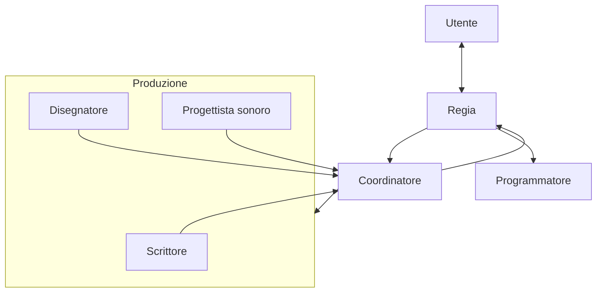
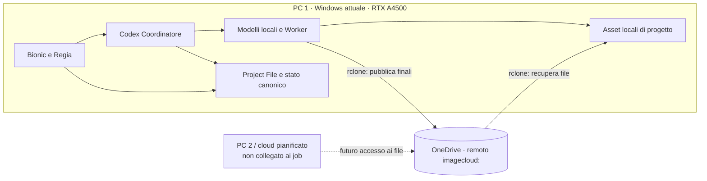
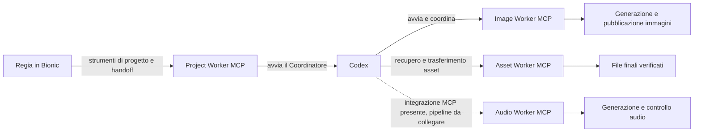
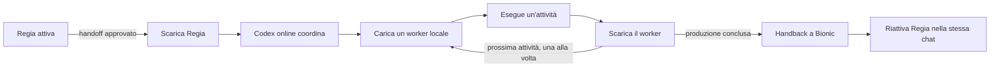

# Architettura locale e cloud per la creazione di visual novel

L’interfaccia grafica principale per la progettazione è LM Studio con Bionic: l’utente conversa con la Regia e sviluppa con lei la direzione creativa. L’obiettivo generale dell’architettura è generare la prima bozza di una visual novel. La modifica di visual novel esistenti resta un obiettivo futuro e non viene definita in questa fase.

Il sistema non è stato progettato per lavorare soltanto in locale. I modelli online possono offrire capacità di ragionamento e coordinamento nettamente superiori; possono dirigere i passaggi tra i worker e stabilire quale processo locale utilizzi la VRAM in un dato momento. Quando un modello locale non raggiunge la qualità o le capacità richieste, il coordinamento può ricorrere al cloud. I modelli locali restano utili per ridurre il consumo dei crediti Codex, la dipendenza dai servizi online e i limiti sui contenuti imposti da singoli modelli cloud, secondo le regole applicabili.

## Hardware e ambiente

Il progetto usa hardware di seconda mano e comprende Shadow PC nell’ambiente di lavoro. Nei controlli operativi disponibili, il PC Windows attuale con GPU NVIDIA RTX A4500 è l’unica macchina verificata per la produzione. Il PC cloud/PC 2 resta per ora teorico e non è collegato all’esecuzione dei job.

## Architettura generale

La Regia sviluppa il progetto con l’utente e registra le informazioni canoniche nel Project File. Dopo l’approvazione della fase creativa, il Coordinatore avvia e governa la produzione, mantenendo ordinato l’uso delle risorse locali. Scrittore, Disegnatore e Progettista sonoro preparano i contenuti; il Coordinatore restituisce i risultati alla Regia per il feedback finale. La programmazione è un passaggio successivo e indipendente dal ciclo creativo.



### Regia

La Regia è il punto di contatto creativo con l’utente e usa l’interfaccia LM Studio/Bionic. Nelle sessioni di progetto verificate è associata a **Qwen 3.5 9B**. Dialoga con l’utente nella sua lingua, confronta le idee e lo aiuta a prendere decisioni su concept, personaggi, relazioni, ambientazioni, eventi, tono e direzione visiva e sonora.

Prima di proporre una nuova fase, la Regia deve leggere il Project File e la documentazione aggiornata del progetto, comprenderne lo stato e i progressi, e consultare i file e gli asset già disponibili. Questo le permette di conoscere personaggi, relazioni, luoghi e continuità, capire cosa è già stato realizzato e individuare contenuti riutilizzabili, evitando duplicazioni o contraddizioni. Se la documentazione non chiarisce un fatto canonico o lo stato del lavoro, la Regia lo segnala e chiede chiarimenti invece di inventarlo.

Le decisioni canoniche vengono conservate nel Project File Markdown, scritto in inglese per essere utilizzato da tutta la pipeline. Quando ritiene definita una fase, la Regia presenta il piano all’utente e richiede un’approvazione esplicita. Solo dopo l’approvazione passa Project File e contesto operativo al Coordinatore.

**Limite attuale:** il Project Worker MCP offre a Regia la lettura del Project File e dello stato di orchestrazione, ma non espone ancora strumenti dedicati per esplorare la cartella del progetto software, la sua documentazione completa o la libreria degli asset. Per soddisfare pienamente questo ruolo, tali fonti devono essere rese consultabili in modo sicuro e circoscritto al progetto; la Regia non deve presumere di averle lette quando non sono accessibili.

### Coordinatore

Il Coordinatore è Codex, configurato per questo flusso con **Codex 6 Luna Light**, un modello online. Il suo compito è organizzare attività e attese, leggere il Project File, attivare i worker necessari e raccogliere i risultati. Il coordinamento e l’attesa dei processi locali sono attività adatte a questo modello leggero; essendo online, il Coordinatore non occupa la VRAM locale.

Codex governa l’uso della VRAM: fa lavorare un modello locale per volta e ne libera la memoria prima di avviare il successivo. Gestisce gli imprevisti in autonomia quando può farlo senza cambiare le decisioni creative approvate; se incontra un blocco o serve una decisione creativa, restituisce il controllo alla Regia nella stessa chat Bionic.

Per avviare le funzioni produttive il Coordinatore usa strumenti MCP. I singoli MCP e le loro responsabilità saranno descritti in una sezione dedicata.

A fine produzione, il Coordinatore restituisce alla Regia un handback con i risultati e i problemi. Bionic riattiva il modello della Regia nella chat originaria, dove la Regia presenta all’utente il feedback finale. Dopo la chiusura del ciclo creativo, Codex può avviare il Programmatore come attività separata.

### Scrittore

Lo Scrittore produce la prima bozza narrativa in inglese a partire dal brief approvato e dalle informazioni canoniche. Il modello Writer attualmente configurato è **Hemmingway 1 Abliterated Extreme**.

Il ciclo Writer → Narrative Reviewer può richiedere correzioni mirate; il Reviewer narrativo attualmente configurato è **Qwen3 8B Narrative Reviewer**. Dopo il suo esito, Codex esegue un controllo finale e può correggere direttamente problemi locali di formato o formulazione, preservando la storia già approvata. La configurazione limita le modifiche finali per evitare riscritture estese.

Il confronto e i campioni dei Writer provati sono documentati in [Confronto dei modelli di narrazione](docs/CONFRONTO-MODELLI-DI-NARRAZIONE.md).

### Disegnatore

Il Disegnatore prepara le immagini coerenti con personaggi, ambienti e momenti narrativi. Il generatore è **`sd-cli.exe`**; i checkpoint attualmente installati sono **SDXL Lightning 4-step** per immagini standard e **Lustify NSFW Checkpoint Zenith v9** per immagini per adulti consensuali.

Codex definisce il prompt visivo, il Worker genera le immagini e Codex esamina i risultati. Un’immagine viene accettata se la valutazione visiva raggiunge la soglia prevista e non rileva errori visivi gravi; altrimenti il processo può correggere il prompt e riprovare entro il limite configurato. Il controller visivo separato non è attualmente installato: il Coordinatore prepara direttamente la richiesta visiva.

### Progettista sonoro

Il Progettista sonoro prepara musica ed effetti coerenti con ciò che accade nella storia. La generazione usa **audio.cpp v0.9.0 Vulkan** con **Stable Audio 3 Medium Q8** per la musica e **Stable Audio 3 Small SFX Q8** per gli effetti.

Il Coordinatore decide quale cue serve e definisce se è musica o effetto, se deve essere un loop, quando parte e quando termina. Audio Worker controlla formato, durata e difetti tecnici; per i loop crea una preview ripetuta. Le misure automatiche non certificano una giunta impercettibile: l’ascolto resta necessario prima dell’approvazione.

Il test e i campioni generati sono documentati in [Confronto dei modelli audio](docs/CONFRONTO-MODELLI-AUDIO.md).

### Programmatore

Il Programmatore è il ruolo che **modifica concretamente il progetto software**: interviene sui file sorgente, integra scene e asset, implementa i comportamenti interattivi e verifica il risultato nel progetto. Codex gli consegna il Project File, la documentazione pertinente, i contenuti approvati, gli asset riutilizzabili e le istruzioni tecniche. Codex coordina il passaggio; non sostituisce il Programmatore nell’editing del progetto.

Codex lo attiva dopo il ciclo creativo e produttivo, come flusso separato dalla conversazione tra utente e Regia. Claude è il Programmatore previsto; la sua integrazione non è ancora attiva. Il Programmatore non usa LM Studio/Bionic per la conversazione creativa: riceve da Codex il pacchetto di lavoro e opera direttamente sul progetto software. Questa fase sarà definita separatamente e non fa ancora parte della produzione corrente.

## PC locale, PC cloud e condivisione dei file

La separazione prevista assegna la direzione creativa e il coordinamento al PC 1, mentre un futuro PC 2 potrà ospitare lavorazioni produttive quando sarà disponibile. Oggi, però, il PC 2 non è accessibile e non esiste un servizio che gli invii job: i test che simulano quel ruolo eseguono effettivamente le attività sul PC 1. La menzione di Shadow PC non costituisce prova che il PC 2 sia già configurato come worker remoto.



### Cosa gira su ciascuna macchina

| Sistema | Stato e responsabilità attuali |
|---|---|
| **PC 1 — Windows attuale** | Host verificato. Qui girano Bionic/Regia, Project Worker, Codex CLI e i worker locali. La generazione immagini e i modelli audio usano le risorse locali, inclusa la RTX A4500. |
| **PC 2 — cloud pianificato** | Non accessibile e non collegato all’orchestrazione. Non risultano configurati dispatch, heartbeat, installazioni di worker o modelli verificati su questa macchina. Se non è disponibile, oggi non interrompe i test: questi avvengono sul PC 1. Quando il flusso dipenderà davvero dal PC 2, l’indisponibilità dovrà fermare quel job e tornare come errore nel handback. |
| **Shadow PC** | È citato nell’ambiente complessivo del progetto, ma le configurazioni operative esaminate non lo identificano come PC 2 attivo. La sua eventuale funzione di host remoto va documentata quando verrà collegato. |

Non si assume che il PC 2 disponga della GPU, dei modelli o degli stessi percorsi del PC 1. Un futuro worker remoto dovrà essere installato e verificato separatamente; OneDrive trasferisce file, non installa modelli e non avvia da solo la generazione.

### Dove risiedono modelli, progetti e asset

| Dati o programmi | Posizione attuale sul PC 1 | Note |
|---|---|---|
| Modelli linguistici LM Studio | `C:\Users\Shadow\.lmstudio\models` | Regia Qwen 3.5 9B; Writer Hemmingway 1 Abliterated Extreme; Narrative Reviewer Qwen3 8B. Sono modelli locali di LM Studio. |
| Checkpoint immagini | `C:\AI\image-worker\models` | SDXL Lightning 4-step e Lustify Zenith v9. |
| Eseguibile Image Worker | `C:\Users\Shadow\.lmstudio\image-worker\bin\sd-cli.exe` | Il server MCP risiede in `C:\Users\Shadow\.lmstudio\image-worker\mcp`. |
| Modelli audio | `C:\AI\audio-worker\models\audio.cpp` | Stable Audio 3 Medium Q8 e Stable Audio 3 Small SFX Q8. |
| Runtime audio.cpp | `C:\Users\Shadow\.lmstudio\audio\audio.cpp\v0.9.0-vulkan` | Il server MCP è in `C:\Users\Shadow\.lmstudio\audio\mcp`. |
| Project File e stato operativo | `C:\AI\bionic\projects` | Il Project File è la fonte canonica; lo stato di handoff è in `.orchestration`. |
| Asset finali locali | `C:\AI\assets\<PROJECT_ID>` | Organizzati per progetto; audio separato in `Audio\SoundEffects` e `Audio\Music`. |

I modelli elencati risiedono sul PC 1, non su OneDrive. Un PC 2 futuro dovrà ricevere i modelli richiesti tramite una propria installazione o un trasferimento controllato; il protocollo di condivisione degli asset non replica automaticamente l’intero catalogo dei modelli.

**Eccezione da riordinare:** Project File e stato di orchestrazione si trovano ancora in `C:\AI\bionic\projects`. Questa è una posizione preesistente mantenuta durante le modifiche ai Worker; non rispetta ancora del tutto l’obiettivo di lasciare sotto `C:\AI` soltanto modelli e asset. Lo spostamento richiede di aggiornare e verificare i percorsi del Project Worker e non è stato eseguito in questa fase.

### OneDrive e rclone

Il programma che collega i worker al cloud file è **rclone**. Il remote già configurato si chiama `imagecloud:` ed è collegato a OneDrive Personal. Il file di configurazione locale di rclone è sotto `%APPDATA%\rclone\rclone.conf`; contiene le credenziali OAuth e non va copiato nel repository, nei Project File o nei log. Ogni PC dovrà autorizzare il proprio accesso a OneDrive e configurare il remote localmente.

Il trasferimento avviene quando il worker chiama rclone: non è una sincronizzazione continua delle cartelle e non costituisce una coda di job remoti.

| Contenuto | Cartella OneDrive usata | Direzione e responsabile |
|---|---|---|
| Immagini finali | `imagecloud:ImageWorker/final/` | Image Worker pubblica; Asset Worker scarica la copia finale in `C:\AI\assets\<PROJECT_ID>`. |
| Effetti sonori finali | `imagecloud:AudioWorker/SoundEffects/final/<PROJECT_ID>/` | Destinazione configurata per WAV e manifest; pubblicazione di un prodotto finale non ancora verificata. |
| Musiche finali | `imagecloud:AudioWorker/Music/final/<PROJECT_ID>/` | Destinazione configurata per WAV e manifest; pubblicazione di un prodotto finale non ancora verificata. |

Il codice usa copie esplicite tramite rclone e controlli sul risultato; non viene eseguito `sync` dell’intero OneDrive. La pubblicazione delle immagini verifica la presenza remota; il trasferimento locale usato nella produzione confronta anche l’hash del file. La pubblicazione audio verifica le dimensioni di WAV e manifest. La rimozione di un file remoto non è automatica nel flusso normale.

Se in futuro il PC 2 dovrà elaborare un asset, potrà scaricare dalla cartella OneDrive autorizzata e pubblicare il risultato nella cartella finale prevista. La richiesta del job, l’assegnazione al PC 2, il controllo che sia online e la gestione dei tentativi sono parti separate da implementare: rclone da solo non le fornisce.

## MCP: strumenti e installazione

Gli MCP sono piccoli server che espongono strumenti ai modelli. In questo progetto separano l’interazione creativa dalla gestione dei file e dalla produzione: Bionic espone alla Regia il Project Worker; Codex usa i worker produttivi durante il coordinamento. I server locali vengono avviati come processi Node.js tramite trasporto standard input/output (stdio), non come servizi web sempre attivi.



### Dove si configurano

Il **Project Worker** è l’unico MCP collegato direttamente a Bionic: fornisce alla Regia gli strumenti per creare e leggere il Project File, registrare il progetto, fare handoff a Codex e recuperare l’handback. In questa installazione è già registrato nella configurazione MCP interna di Bionic, sotto `C:\Users\Shadow\.lmstudio\apps\bionic\.internal`. È una configurazione gestita dall’applicazione: non va duplicata né modificata a mano durante una normale installazione. Il comando `lms` disponibile in questo PC non offre un sottocomando `mcp`; quindi l’aggiunta dei server a Bionic si fa dalle impostazioni MCP dell’app, se occorre ripristinarla.

I quattro server sono configurati anche per Codex in `C:\Users\Shadow\.codex\config.toml`: Project Worker, Image Worker, Asset Worker e Audio Worker. Il Coordinatore può inoltre avviare alcuni worker come processi MCP figli quando servono. La presenza di un server nella configurazione di Codex non implica che ogni fase lo utilizzi: la pipeline narrativa verificata collega Project Worker, Image Worker e Asset Worker; Audio Worker è configurato, ma va ancora collegato e verificato nel flusso completo.

### Requisiti comuni

- Windows, Node.js e npm. In questa macchina sono presenti Node.js 24 e npm 11.
- Codex CLI per i worker usati dal Coordinatore.
- Le dipendenze e i programmi specifici del worker, come `sd-cli.exe` e `audio.cpp`, oltre ai modelli richiesti. I modelli non si installano con `npm`.
- Le cartelle di lavoro e dei modelli indicate nelle configurazioni. I file sorgente MCP sono sotto `C:\Users\Shadow\.lmstudio`; alcuni percorsi di lavoro e modelli puntano a `C:\AI`.

Per installare le dipendenze JavaScript di un worker, aprire PowerShell nella sua cartella `mcp` ed eseguire:

```powershell
Set-Location "$env:USERPROFILE\.lmstudio\NOME-WORKER\mcp"
npm ci
```

`npm ci` usa il lockfile presente e installa le dipendenze previste per quel server. Ripetere l’operazione nella cartella di ciascun worker. Non copiare `node_modules` da un’altra macchina: ricrearlo con il lockfile mantiene le versioni coerenti.

### Project Worker MCP

**Percorso del server:** `C:\Users\Shadow\.lmstudio\project-worker\mcp\server.mjs`.

1. Verificare Node.js e installare le dipendenze eseguendo `npm ci` da `C:\Users\Shadow\.lmstudio\project-worker\mcp`.
2. In Bionic, aggiungere un server locale di tipo stdio con comando `node` e argomento `C:\Users\Shadow\.lmstudio\project-worker\mcp\server.mjs`. La cartella di lavoro deve essere `C:\Users\Shadow\.lmstudio\project-worker\mcp`.
3. Nell’installazione corrente Bionic ha già registrato il Project Worker nel proprio file interno `ng-mcp.json`, con un timeout di 65 minuti per le attese di handoff; non aggiungere una seconda voce né modificare quel file a mano.
4. Per registrare lo stesso server anche nel Codex CLI, usare:

   ```powershell
   codex mcp add project-worker -- node C:\Users\Shadow\.lmstudio\project-worker\mcp\server.mjs
   ```

5. Riavviare o ricaricare la connessione MCP in Bionic e controllare che gli strumenti del Project Worker risultino disponibili. Registrare poi il Project File con il tool dedicato; non inserire a mano l’UUID della chat.

Questo server coordina le fasi, ma non genera direttamente immagini o audio. La produzione dei contenuti spetta ai worker specializzati.

### Image Worker MCP

**Percorso del server:** `C:\Users\Shadow\.lmstudio\image-worker\mcp\server.mjs`.

1. Eseguire `npm ci` da `C:\Users\Shadow\.lmstudio\image-worker\mcp`.
2. Verificare il programma `sd-cli.exe`, i checkpoint richiesti e `rclone` con il trasporto `imagecloud:` già configurato.
3. Aggiungere il server a Codex con il comando:

   ```powershell
   codex mcp add image-worker -- node C:\Users\Shadow\.lmstudio\image-worker\mcp\server.mjs
   ```

4. Eseguire `codex mcp list` e verificare che `image-worker` sia attivo. Le sue funzioni generano immagini, richiedono la revisione di Codex, finalizzano l’immagine scelta e la pubblicano.

Il codice MCP e lo staging temporaneo sono sotto `.lmstudio`; `C:\AI\image-worker` contiene invece i checkpoint e le immagini finali. Questa separazione mantiene il codice dei Worker fuori da `C:\AI`, che conserva modelli e asset. Se si spostano queste cartelle dati, vanno aggiornati i percorsi configurati nel Worker.

### Asset Worker MCP

**Percorso del server:** `C:\Users\Shadow\.lmstudio\asset-worker\mcp\server.mjs`.

1. Eseguire `npm ci` da `C:\Users\Shadow\.lmstudio\asset-worker\mcp`.
2. Verificare `rclone` e la configurazione del remote `imagecloud:`. Il worker limita le operazioni remote alla cartella finale `ImageWorker/final`.
3. Aggiungere il server a Codex:

   ```powershell
   codex mcp add asset-worker -- node C:\Users\Shadow\.lmstudio\asset-worker\mcp\server.mjs
   ```

4. Controllare `codex mcp list`. Il worker verifica la presenza di un asset locale, scarica un’immagine finalizzata e permette di eliminare la copia remota soltanto dopo aver verificato che la copia locale sia valida.

### Audio Worker MCP

**Percorso del server:** `C:\Users\Shadow\.lmstudio\audio\mcp\server.mjs`.

1. Eseguire `npm ci` da `C:\Users\Shadow\.lmstudio\audio\mcp`.
2. Verificare il runtime `audio.cpp` Vulkan e i modelli installati in `C:\AI\audio-worker\models`. Il worker usa anche Python e i moduli `numpy` e `soundfile` per ispezione e preview. In questa macchina il comando `python` non risulta disponibile nel `PATH`: installare Python e questi moduli, poi verificare che `python --version` e `python -c "import numpy, soundfile"` funzionino da una nuova finestra PowerShell.
3. Aggiungere il server a Codex. La configurazione attuale usa `C:\Program Files\nodejs\node.exe`; il comando di registrazione è:

   ```powershell
   codex mcp add audio-worker -- 'C:\Program Files\nodejs\node.exe' C:\Users\Shadow\.lmstudio\audio\mcp\server.mjs
   ```

4. Eseguire `codex mcp list`; poi controllare lo strumento `system_status` per verificare runtime, modelli e cartelle. Per completare l’installazione funzionale occorre anche collegare questo MCP alla pipeline del Coordinatore: la sola registrazione in Codex non avvia ancora generazione sonora nel flusso narrativo end-to-end.

### Controllo e manutenzione

Per vedere i server registrati in Codex usare `codex mcp list`; per i dettagli di un singolo server, `codex mcp get NOME`. Le modifiche alla configurazione Codex richiedono una nuova sessione del client per essere caricate in modo affidabile. Se un server non si avvia, controllare nell’ordine percorso di `server.mjs`, percorso di Node.js, `node_modules`, programmi esterni, modelli e cartelle richieste. Non copiare segreti o credenziali nei file di configurazione o nei log.

Gli MCP locali possono eseguire codice e accedere ai percorsi concessi al processo. Installare soltanto il codice conservato nel progetto e controllare i confini dei percorsi prima di allargare permessi o cartelle scrivibili.

Per le istruzioni dei client consultare la [guida MCP di LM Studio](https://lmstudio.ai/docs/app/mcp) e la [documentazione MCP per Codex](https://developers.openai.com/learn/docs-mcp). La struttura interna `ng-mcp.json` usata da questa installazione Bionic è specifica dell’applicazione e non va sostituita con un file di configurazione standard di un altro host MCP.

### Uso della VRAM

Il modello online del Coordinatore non occupa la VRAM della macchina locale. I modelli locali vengono caricati in sequenza; al termine di un’attività vengono scaricati prima di passare al worker successivo. Quando serve di nuovo la Regia, Bionic riattiva il modello nella sessione originale.


